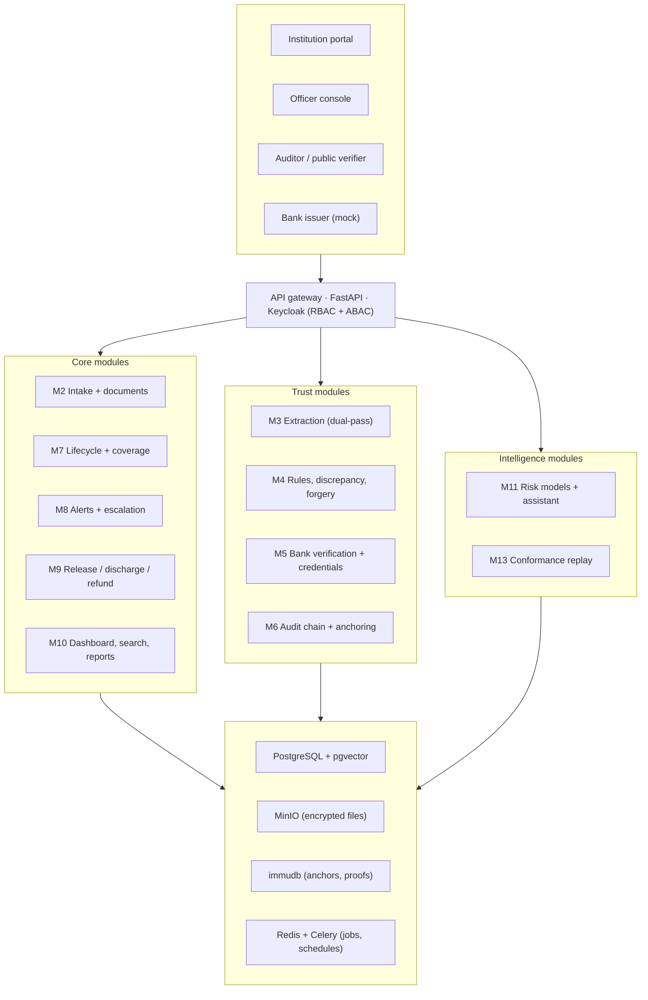
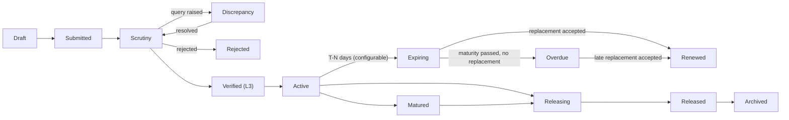
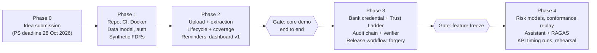

# DepositTrack — Implementation Plan (SIH 2026 · PS SIH26265)

**Problem statement:** SIH26265 · *Streamline of security deposit/ FDR portal* · AICTE, Regulation Bureau · Software · Smart Automation
**Source:** https://www.sih.gov.in/sih2026PS (read 21 Oct 2026; idea submission deadline listed as 28 Oct 2026)
**Inputs consolidated:** `research/krrish/FDR-Guardian-SIH-26265-Implementation-Plan.md`, `research/Mayank_Kathe/Mayank-Research-Notes-SIH-26265.md`, and the 15 papers in `research/`. Every paper claim below was re-checked against the paper text; corrections to the earlier notes are listed in [§4.3](#43-corrections-to-earlier-research-notes).

---

## Contents

1. [Executive summary](#1-executive-summary)
2. [The problem, in AICTE's own words](#2-the-problem-in-aictes-own-words)
3. [Objective traceability matrix](#3-objective-traceability-matrix)
4. [Research basis](#4-research-basis)
5. [Novel solution](#5-novel-solution)
6. [System architecture](#6-system-architecture)
7. [Data model and lifecycle](#7-data-model-and-lifecycle)
8. [Module-by-module build specification](#8-module-by-module-build-specification)
9. [AI / ML components](#9-ai--ml-components)
10. [Security, privacy and compliance](#10-security-privacy-and-compliance)
11. [Testing: SIH scenarios and KPIs](#11-testing-sih-scenarios-and-kpis)
12. [Roadmap](#12-roadmap)
13. [Risks and fallbacks](#13-risks-and-fallbacks)
14. [Open questions for AICTE (not assumed)](#14-open-questions-for-aicte-not-assumed)
15. [Repository layout](#15-repository-layout)
16. [References](#16-references)

---

## 1. Executive summary

**DepositTrack** is a secure, centralized portal for the AICTE Regulation Bureau that manages every security deposit and Fixed Deposit Receipt (FDR) from submission to release.

It does four things that a plain records portal does not:

1. **It knows who vouches for every field.** Each value (amount, maturity date, lien status…) carries a provenance level, from *institution-declared* up to *bank-attested* and *live-confirmed*. This directly answers the PS line: *"distinguish between information submitted by an institution and information independently confirmed by an authorized bank or financial source."*
2. **It tracks obligations, not just documents.** An institution owes a requirement (amount × time window). DepositTrack computes, day by day, whether that requirement is actually covered by valid instruments, and shows the **coverage gap** before it happens.
3. **Every action is provable.** Hash-chained audit events, periodic Merkle anchoring and a public file verifier let an auditor prove what was submitted, when, and by whom, without trusting the database admins.
4. **It warns early, with reasons.** Configurable T-minus reminders, plus a renewal-risk model that escalates likely misses earlier, with human-readable reasons. AI only suggests; a named officer always decides.

**One-line pitch:** *Every deposit in one place, every rupee checked against the bank, every action provable, and every coverage gap flagged before it opens.*

The build has three layers:

| Layer | Contents | Demo priority |
| --- | --- | --- |
| **Core** | Repository, upload, extraction, lifecycle engine, reminders, release workflow, dashboard, reports, audit trail, RBAC | Must work end to end |
| **Trust** | Trust Ladder, bank-signed e-FDR credential, freshness and decay, duplicate/double-pledge detection, forgery signals, Merkle anchoring | Main differentiator |
| **Intelligence** | Coverage forecasting, renewal-risk model with reasons, procedural conformance replay, clause-linked explanations, officer assistant | Wow factor, built after the core gate |

---

## 2. The problem, in AICTE's own words

### 2.1 Background (summarised from the PS)

AICTE may require technical institutions to submit or maintain security deposits / FDRs as part of approval and compliance. The work involves:

- keeping institution-wise records;
- verifying the submitted instruments;
- monitoring validity and maturity;
- tracking renewal or replacement;
- recording release and refund requests;
- keeping documents available for regulatory verification.

Today this runs on fragmented records, manual correspondence and multiple trackers. As a result, nobody has an accurate, current view of deposit status, pending actions and deadlines.

### 2.2 Every requirement stated in the PS

The ten numbered capabilities are listed in §3. The *Detailed Description* also asks for the following, which are easy to miss and are tracked as explicit requirements here:

| ID | Requirement (PS wording, condensed) |
| --- | --- |
| R-a | Records include reference numbers, issuing bank details, amount, issue date, maturity date, validity status, supporting documents, current administrative status |
| R-b | Verify through *legitimate bank-issued verification mechanisms wherever supported* |
| R-c | Identify **incomplete records** and flag discrepancies |
| R-d | **Distinguish institution-submitted vs bank/financial-source-confirmed** information |
| R-e | Track maturity, validity, renewal/replacement and *other prescribed timelines* |
| R-f | **Configurable** reminders; overdue/unresolved cases flagged for follow-up |
| R-g | Release, **discharge** or refund, subject to regulations, prescribed conditions and **competent-authority authorization** |
| R-h | Dashboard: active, expiring, matured, renewed, released, pending |
| R-i | Users can **search records, review document histories, update permitted fields, record scrutiny observations, monitor case status** |
| R-j | Automated reports: pending verifications, upcoming maturities, **missing documents**, cases requiring intervention |
| R-k | Role-based access, secure storage, encryption, audit trails, controlled access |
| R-l | Integration with AICTE systems and bank verification *where technically feasible and formally authorized*, to reduce duplicate entry |

### 2.3 Evaluation criteria in the PS

- **Measurable improvements** in five areas:
  - record accuracy;
  - verification turnaround time;
  - timely renewal monitoring;
  - reduction in manual tracking effort;
  - visibility into pending cases.
- **Test scenarios:** new FDR submission, validity tracking, approaching maturity, renewal, discrepancy identification, authorized release processing.

§11 maps every one of these to an automated test and a measured KPI.

### 2.4 Actors

| Actor | Role in DepositTrack |
| --- | --- |
| Institution user | Submits instruments, confirms extracted fields, responds to queries, requests renewal/release, sees own status |
| Scrutiny officer (Regulation Bureau) | Reviews submissions, records scrutiny observations, raises/clears discrepancies |
| Verifying officer / Finance | Triggers and records bank verification |
| Competent authority | Approves release/discharge/refund; any override needs a recorded reason |
| Bank (integration actor) | Issues signed confirmation; confirms lien marking and lien removal |
| Auditor | Read-only access to full history and integrity proofs |
| System admin | Users, roles, rule configuration, reminder schedules, master data |

The exact officer hierarchy and delegation levels are **not** stated in the PS (see §14).

---

## 3. Objective traceability matrix

This matrix is the contract for the build. Every PS capability maps to modules, a novel element where one applies, a research basis and an acceptance test.

| # | PS capability | Modules (§8) | Novel element (§5) | Research basis (§4) | Acceptance test (§11) |
| --- | --- | --- | --- | --- | --- |
| 1 | Centralized repository | M1, M2, M10 | N2 Obligation–Coverage model | — | T-01, T-02 |
| 2 | Digital document management | M2, M3 | N6 Dual-pass extraction | P3 LayoutLMv3, P13 IDP Accelerator, P12 Multi-agent review | T-01 |
| 3 | Verification and discrepancy detection | M4, M5 | N1 Trust Ladder, N3 e-FDR credential, N7 Double-pledge, N8 Clause-linked flags | P7 SSI survey, P4 RGB forgery, P6 SHAP/Anchor, P14 Regulatory graphs | T-05, T-06, T-07 |
| 4 | Validity and maturity tracking | M7, M8 | N2 Coverage gap forecast | P10 Smart-contract FD | T-03, T-04 |
| 5 | Renewal and replacement monitoring | M7 | N2 continuity check, instrument chain | P2 Revocation (chained status records) | T-08 |
| 6 | Release and refund workflow | M9 | N5 Policy-as-code with time boxes | P1 SMTSEC, P15 Audit-trail compliance rules | T-09 |
| 7 | Alerts and escalation | M8 | N9 Renewal-risk with reasons | P5 Predictive monitoring benchmark, P6 SHAP/Anchor | T-04, T-10 |
| 8 | Dashboard and reports | M10 | N2 Coverage strip, verification exposure | P11 Compliance monitoring review (result types) | T-11 |
| 9 | Audit trail and access control | M1, M6 | N4 Verifiable audit + freshness, N10 Conformance replay | P2 Revocation, P15 Audit trail, P11 Compliance review | T-12, T-13 |
| 10 | Integration and data security | M5, M12, §10 | N3 e-FDR credential, IFSC lineage | P7 SSI survey, P9 Blockchain finance survey | T-12, T-14 |

**Additional requirements → modules:**

| ID | Modules |
| --- | --- |
| R-a | M2 schema |
| R-b | M5 |
| R-c | M4 completeness rules |
| R-d | N1 |
| R-e | M7 configurable timelines |
| R-f | M8 |
| R-g | M9 with discharge as a case type |
| R-h | M10 |
| R-i | M10 search, M2 versions, M1 field-level edit permissions, M4 observations |
| R-j | M10 reports |
| R-k | M1, M6, §10 |
| R-l | M12 |

---

## 4. Research basis

### 4.1 Paper map (verified against the PDFs)

**Key:** P1–P8 are in `research/krrish/`; P9–P15 are in `research/Mayank_Kathe/`.

| ID | Paper | What it actually contributes | Used in |
| --- | --- | --- | --- |
| P1 | Ahmadisheykhsarmast & Sonmez, *A smart contract system for security of payment of construction contracts*, Autom. Constr. 120 (2020) | SMTSEC contract with explicit parameters (contingency %, PeriBloc blocking period — 30 days in their example, PeriPay payment period); funds transfer automatically once a payment is approved; interviews (Table 4) flag lack of legal infrastructure as a disadvantage | M9 time-boxed, parameterised release (N5); final approval always human |
| P2 | Elloh Adja, Hammi, Serhrouchni, Zeadally, *A blockchain-based certificate revocation management and status verification system*, Comput. Secur. 104 (2021) | Revoked certificates held in Bloom filters per distribution point; status records carry *last update* / *next update* freshness fields (Fig. 4); Merkle root over record fields, signed (Fig. 5) | N4 freshness + decay, M5 revocation of released FDRs, M6 anchoring |
| P3 | Huang et al., *LayoutLMv3*, ACM MM 2022 | Unified text + layout + image Transformer; base = 133M params; 92.08 F1 on FUNSD (fine-tuned at lr 1e-5, batch 16); ablation: a 125M text+layout-only model gets 88.64 F1 | M3 key-field extraction |
| P4 | Gornale, Patil, Benne, *Document Image Forgery Detection Using RGB Color Channel*, TMLAI 10(5) 2022 | 9 GLCM features (contrast, homogeneity, energy × R, G, B); block-wise comparison; 93.11% on printed, 95.8% on handwritten; 950 images, resized to 100×100, threshold 40; 10 forgery types | M4 forgery signal (one of several, never a verdict) |
| P5 | Rama-Maneiro, Vidal, Lama, *Deep Learning for Predictive Business Process Monitoring: Review and Benchmark*, IEEE TSC 2023 | 10 approaches on 12 event logs; Navarin et al.'s direct remaining-time approach ranked best for remaining time; Tax et al. LSTM top for next activity; reusable preprocessing / split protocol | N9 event-log design and evaluation protocol |
| P6 | Thanathamathee et al., *SHAP-Instance Weighted and Anchor Explainable AI: Enhancing XGBoost for Financial Fraud Detection*, Emerging Sci. J. 8(6) 2024 | XGBoost with SHAP-based instance weights; Anchor if-then explanations; three classes (non-fraudulent / grey area / fraudulent) derived from score bands; compares SMOTE and K-CGAN oversampling | M4 risk score with grey band; N9 reasons |
| P7 | Ahmed, Islam, Shatabda, Islam, *Blockchain-Based Identity Management System and Self-Sovereign Identity Ecosystem: A Comprehensive Survey*, IEEE Access 2022 | Issuer–holder–verifier model, verifiable credentials, DIDs, revocation; five IDMS properties: authentication, integrity, privacy, trust, simplicity | N3 e-FDR credential; §10 security framing |
| P8 | Es, James, Espinosa-Anke, Schockaert, *RAGAS*, EACL 2024 demo | Reference-free faithfulness, answer relevance and context relevance; agreement with humans 0.95 / 0.78 / 0.70 | M11 assistant evaluation |
| P9 | Wu, Yao, Liu et al., *Blockchain for Finance: A Survey*, arXiv:2402.17219 (2024) | 12 platforms (6 finance-related detailed); 4 application categories; Table 2: permissioned/alliance chains with PoA/BFT reach millisecond-order processing vs minutes for public chains; DeFi attack factors (code bugs, third-party protocol abuse, flash loans, frontend hijacking) | M6 choice of permissioned anchoring; §10 key and code-audit controls |
| P10 | Rawat & Rahman, *Smart Contract Based Approach for Fixed Deposit in Blockchain Networks with Remix IDE*, IJCRT 11(5) 2023 | Ethereum contract with User / Bank / Financial-service-provider roles; automatic payout at maturity; early break allowed after an authentication step, with interest forfeited and a charge deducted. Mostly qualitative, with no quantitative results | M7 lifecycle framing; M9 authenticated early-release path |
| P11 | Klessascheck & Pufahl, *Reviewing Uses of Regulatory Compliance Monitoring*, arXiv:2501.10362 (v5, 2025) | SLR of 41 conformance-checking + 17 compliance-checking studies; preparation → action → reflection phases; result types: qualify, quantify, break down/compare, explain, localize; *all studies rely on manual creation of the prescriptive model*; real-time alerting found in only one study | N10 conformance replay; M10 result types; policy-as-code validated by experts |
| P12 | Wan, Deng, Zou, Xu, *Enhancing the Efficiency and Accuracy of Underlying Asset Reviews in Structured Finance: The Application of Multi-agent Framework*, arXiv:2405.04294 (2024) | LLM reader → extraction → evaluation agents cross-check loan applications vs bank statements (synthetic, 49 + 49 docs); GPT-4 accuracy 0.99; dual-agent cross-verification reached 100% on their set; multi-line addresses are a weak spot (0.67 for open models); cost per document reported | N6 dual-pass extraction; cost-per-document KPI |
| P13 | Islam, Salekin, King et al. (AWS), *IDP Accelerator: Agentic Document Intelligence from Extraction to Compliance Validation*, arXiv:2602.23481 (2026) | Packet splitting (DocSplit), configurable multimodal extraction, rule validation that first gathers facts then returns determination + evidence + recommendation; human review below a configurable confidence threshold (default 0.8); OCR + image input beat image-only | M3 pipeline and HITL; M4 fact-then-rule validation |
| P14 | Khanvilkar & Kommuru, *Regulatory Graphs and GenAI for Real-Time Transaction Monitoring and Compliance Explanation in Banking*, arXiv:2506.01093 (2025) | GCN over a *transaction* graph with temporal decay; flagged items get top-k regulatory clauses retrieved from a FAISS index and a GPT-4 explanation; F1 98.2% on Elliptic; notes generated justifications are sometimes inconsistent | N8 clause-linked flag explanations; temporal decay in N9 features |
| P15 | Keating, *Blockchain-Enabled Audit Trails for Compliance and Security in Cloud-Based Payment Systems* (preprint, 2024) | Conceptual: hash-chained logs on a permissioned ledger (PBFT/PoA), compliance rules as smart contracts, *initiate → verify → log → notify → audit* flow, least-privilege access. No experimental results | M6 hash chain; M9 verify-log-notify flow |

### 4.2 What no paper covers (our contribution)

| Gap | Why it matters for AICTE | DepositTrack answer |
| --- | --- | --- |
| Obligation coverage over time | A deposit is a *requirement over a time window*, not a single document; renewals must be continuous | N2 Obligation–Coverage model |
| Provenance per field, with freshness | The PS explicitly demands institution-vs-bank distinction | N1 Trust Ladder + N4 freshness decay |
| Bank-signed FDR confirmation | Today's slowest step is letter/email verification | N3 e-FDR credential (proposal; simulated in prototype) |
| Same FDR used twice, and bank mergers renaming IFSCs | Real fraud and data-quality risks specific to Indian FDRs | N7 canonical instrument key with IFSC lineage |
| Regulator's multi-step release with prescribed conditions | Not modelled in any paper | N5 policy-as-code release |
| Process-conformance audit of the regulator's own procedure | P11 shows prescriptive models are manual and rarely validated | N10 conformance replay with expert-validated constraints |

### 4.3 Corrections to earlier research notes

These were found during verification and are **not** carried into this plan. The paper PDFs remain the source of truth.

**Mayank's notes, P9–P15:**

- **P14 (Regulatory Graphs):** the GNN runs over a *transaction* graph. Regulations are stored as a flat FAISS clause index, not a regulatory knowledge graph, and the paper has no dashboard design.
- **P12 (Multi-agent):**
  - The agents are reader / extraction / evaluation (plus data generation), not "extraction / cross-validation / anomaly / report".
  - There is no "60–80% review-time reduction" figure; the paper reports no time measurements.
- **P13 (IDP Accelerator):**
  - The default confidence threshold is **0.8**, not 0.85.
  - Retries come from the orchestration layer; only the analytics module is described as agentic.
- **P15 (Audit trail):**
  - The paper is from 2024 and the author is Layla Keating.
  - It has no Merkle anchoring, no read-only auditor node and no measured benchmarks.
- **P9 (Blockchain finance):**
  - Table 3 compares IPO/ICO/STO; the consensus comparison is the qualitative Table 2.
  - The paper has no CPMI-IOSCO mapping.
  - Oracle manipulation and front-running are not among its attack factors.
- **P11 (Compliance review):**
  - It uses three phases, not four stages.
  - It does not claim "alert generation is under-researched" (it notes real-time alerting in only one study).
  - It covers conformance checking, not prediction.
- **P10 (Smart-contract FD):**
  - The paper defines no state machine, no KYC/dispute gates and no renewal logic.
  - It has no code-level details such as `block.timestamp`.

**Krrish's plan, P1–P8:**

- **P1:** "auto-release if no action" overstates SMTSEC. Payment is automatic after approval, and PeriPay governs requests.
- **P3:** the 88.64 F1 ablation is a 125M text+layout model, not the 133M base.
- **P5:** say "Navarin's direct approach ranked best", not a general "direct beats recursive" finding.
- **P6:** the "precision 0.96" Anchor rule was illustrative, not from the paper.

---

## 5. Novel solution

Ten novel elements, grouped by layer. Headline novelties N1–N3 lead the pitch; each one can be demoed in under 60 seconds.

### N1. Trust Ladder — per-field provenance (headline)

Every field of every instrument stores up to three values (declared, extracted, bank) plus a provenance level:

| Level | Name | Reached when |
| --- | --- | --- |
| L0 | Declared | Typed or uploaded by the institution |
| L1 | Machine-checked | Extraction agrees with the declared value; rules pass; forgery signals low |
| L2 | Officer-verified | A named officer confirmed it during scrutiny (logged with reason) |
| L3 | Bank-attested | A bank-signed credential (N3) or authorised bank channel matches the field |
| L4 | Live-confirmed | The bank/authorised source confirms *current* status (not closed, lien intact) within its freshness window |

- **Instrument trust** = the minimum trust over its key fields (amount, instrument number, IFSC, maturity date, lien status). The weakest field decides.
- **UI:** a coloured badge on every field and every instrument. The dashboard can filter by trust level.
- **Covers:** R-d directly, and capability #3.

### N2. Obligation–Coverage model with gap forecasting (headline)

The core modelling idea. Existing tools track *documents*; AICTE actually cares whether an *obligation* is covered.

- **Obligation:** what an institution owes. `institution, basis (approval case / rule reference), required_amount, required_from, required_until, conditions (e.g. beneficiary wording, lien)`. Obligations are generated from configurable rules; the actual amounts and durations come from AICTE (see §14).
- **Coverage:** an allocation of an instrument (or part of one) to an obligation, valid from its issue date to its maturity/validity date.
- **Coverage function:** for each obligation and day *t*, sum the amounts allocated from instruments valid on day *t*:

```math
C(t) = \sum_{i \in \text{valid}(t)} a_i \qquad \text{gap}(t) = \max\big(0,\ R(t) - C(t)\big)
```

- The system computes two curves:
  - **Declared coverage** C₀(t) counts all instruments at trust level L0 or above.
  - **Attested coverage** C₃(t) counts only instruments at L3 or above.
  - **Verification exposure** = C₀(t) − C₃(t): rupees that AICTE is relying on but no bank has confirmed. This one number joins N1 and N2.
- **Gap forecasting:** an interval sweep over future dates finds the first day each obligation becomes under-covered (maturity without renewal, amount shortfall, partial release). That date becomes a task and drives reminders.
- **Renewal continuity check:** a replacement must start on or before the old instrument's maturity, and its amount must be at least the requirement. Otherwise a *continuity gap* flag is raised. This makes PS capability #5 checkable rather than just recordable.
- **UI:** a "coverage strip" timeline per institution (green = covered and attested, amber = covered but only declared, red = gap).

### N3. Bank-signed e-FDR credential (headline; proposal, simulated in the prototype)

- **Model:** the issuer–holder–verifier model from P7.
  - The **bank** issues a small signed JSON credential per FDR.
  - The **institution** holds it and submits it.
  - **AICTE** verifies it offline using the bank's pinned public key.
- **Release:** when the lien is removed on release, the bank revokes the credential. Its status record carries last/next-update fields (P2), so a stale status is detectable.
- **Precedent:** this extends the idea behind India's electronic bank guarantee and bank-to-bank BG advice to FDRs. The prototype uses a mock bank with Ed25519 signatures. Production would need a formal bank agreement (§14).
- **No personal data:** the credential carries no depositor PAN, phone or account numbers.

```json
{
  "type": "FDRAttestation",
  "issuer": "bank:<BANKCODE>:key-2026-01",
  "issued_at": "2026-03-12T10:41:00+05:30",
  "subject": {
    "instrument_no": "<FDR number>",
    "ifsc": "<IFSC>",
    "amount_inr": 0,
    "issue_date": "YYYY-MM-DD",
    "maturity_date": "YYYY-MM-DD",
    "beneficiary": "<as printed>",
    "lien_status": "MARKED"
  },
  "status": {"registry": "bank:<BANKCODE>:fdr-status", "index": 0,
             "last_update": "…", "next_update": "…"},
  "signature": "ed25519:…"
}
```

### N4. Verifiable audit trail with trust freshness

- **Hash chain:** every event is chained per instrument: `hash = SHA256(prev_hash ‖ canonical_json(event))`.
- **Anchoring:** periodically, a Merkle root over new events and document hashes is written to a tamper-evident store (immudb in the prototype; a permissioned ledger is the production option, per P9 Table 2).
- **Public verifier:** drop in any file and get either *"submitted on ⟨date⟩ by ⟨institution⟩, unchanged"* or *"no match"*.
- **Freshness and decay (from P2's next-update idea):** every L3/L4 confirmation carries `next_update`.
  - Once it passes without a re-check, L4 automatically drops to L3.
  - If the credential is revoked or the bank reports closure, the instrument drops to L0 and is flagged *critical*.
  - Trust is therefore time-bound, never permanent.

### N5. Policy-as-code release, discharge and refund (from P1, P10, P15)

- Release conditions are versioned, testable rule sets per case type: release / discharge / refund / early break.
  - Each rule cites the regulation clause it implements.
  - The rule version used is recorded in the audit trail.
- **Time boxes (the SMTSEC parameter idea):**
  - The institution has X days to answer a query, then the request auto-closes with notice.
  - Officers have Y days to act, then the case escalates.
  - X and Y are configured per case type.
- **Flow:** verify → log → notify at every step (P15).
- **Approval:** final approval is always a named competent authority with a mandatory reason.
- **Early release** (before the end of the prescribed period) requires an extra authenticated approval step, mirroring P10's authenticated early break.

### N6. Dual-pass extraction with disagreement routing (from P12, P13)

- **Two independent passes:** (a) OCR + LayoutLMv3 token classification and (b) OCR + rules/LLM key-value extraction.
  - Fields where the passes disagree, or where confidence is below the threshold (default 0.8, as in P13), are forced to human confirmation.
  - Known weak fields, such as multi-line addresses (P12), always go to a human.
- **Amount check:** the amount in figures is cross-checked against the amount in words.

### N7. Canonical instrument key, double-pledge and IFSC lineage

- **Canonical key:** `canonical_bank(IFSC) + normalised instrument number`, unique across all institutions.
  - A duplicate means the same FDR has been submitted twice or is backing two institutions, and raises a *critical* flag instantly.
  - Fuzzy matching (edit distance on the instrument number within the same bank) catches typos and deliberate near-duplicates.
- **IFSC lineage:** a lineage table maps old IFSC codes to current ones, because Indian bank mergers change IFSC codes. An old FDR from a merged bank still matches its current identity, and the bank's verification key is resolved correctly.
  - Lineage is seeded from the public RBI IFSC master. The exact source is to be confirmed (§14).

### N8. Clause-linked discrepancy explanations (from P14, P6, P13)

- **Every flag has three parts:**
  1. the **fact** gathered (P13's facts-then-rules);
  2. the **rule** that failed, with its clause reference from N5;
  3. a **plain-language reason**.
- **Retrieval:** when a rule has no direct clause mapping, the top-k clauses are retrieved from a vector index of the AICTE handbook/circulars (P14's FAISS-retrieval pattern). An LLM may draft the sentence, but the decision comes from the deterministic rule, never the LLM (P14 itself reports inconsistent generated justifications).
- **Risk classes:** the risk model outputs *genuine / grey area / suspicious* from configurable score bands (P6), with SHAP and Anchor-style reasons.

### N9. Renewal-risk forecasting with reasons (from P5, P6, P14)

- **Prediction:** the probability that an institution misses a renewal or response deadline, from its event history:
  - past lateness;
  - median response time;
  - open discrepancies;
  - days to maturity;
  - bank;
  - amount;
  - recency-weighted activity, using temporal decay (P14).
- **Escalation:** high-risk cases escalate earlier (e.g. at T-30 instead of T-7). Every escalation shows its reasons.
- **Evaluation:** follows P5's protocol (prefix encoding, chronological split). A direct remaining-time regressor is used because Navarin's direct approach ranked best in P5.

### N10. Procedural conformance replay (from P11)

- **Prescriptive constraints:** the Regulation Bureau's own procedure is written as constraints over the event log. Examples:
  - *"release approved ⇒ checklist complete before approval"*;
  - *"lien-removal confirmation within N days after release letter"*;
  - *"scrutiny observation recorded before discrepancy closed"*.
- **Nightly replay:** a job replays every case against the constraints and reports the result types identified in P11: quantify (conformance %), qualify (violated / not), localize (which event), explain (why).
- **Validation:** P11 found that prescriptive models are always built manually and rarely validated. Our constraints are therefore reviewed by an AICTE official and versioned (§14).
- **UI:** a "procedural compliance" panel for auditors.

---

## 6. System architecture

A modular monolith: one Python backend split by module folders, one web frontend, and one Docker Compose file. Modules can later be split into services.



### 6.1 Data flow for one submission

1. The institution uploads a scan and types (or accepts) key fields. The gateway checks role + attributes. M2 stores the file encrypted in MinIO and records its SHA-256 and version in PostgreSQL.
2. M3 runs dual-pass extraction. Disagreements and low-confidence fields go back to the user for confirmation.
3. M4 runs completeness rules, policy rules, the duplicate key, forgery signals and the risk score. It writes flags (fact, rule, clause, reason). Trust rises to L1 if clean.
4. M5 verifies the bank credential, or opens a manual verification task with an SLA timer. Trust rises to L3 on a match.
5. M7 allocates the instrument to its obligation, recomputes coverage and schedules maturity milestones. M8 plans reminders.
6. Every step writes an audit event (M6). Anchoring runs on schedule.

### 6.2 Tech stack

| Layer | Choice | Reason |
| --- | --- | --- |
| Frontend | Next.js + React, Tailwind, shadcn/ui, Recharts | Fast to build accessible dashboards |
| API | FastAPI (Python 3.11), Pydantic | Same language as the ML code; auto OpenAPI docs |
| Auth | Keycloak (OTP/MFA, roles) | SSO-ready; can federate with government SSO later |
| Jobs | Celery + Redis, Celery beat | Retries for OCR/bank calls; daily lifecycle and coverage sweep |
| Database | PostgreSQL 16 + pgvector | Relational core plus clause retrieval in one store |
| Files | MinIO (S3-compatible), server-side encryption | Local and cloud-portable |
| Tamper evidence | immudb (production option: permissioned ledger, PoA/BFT) | Inclusion/consistency proofs out of the box |
| OCR / doc AI | docTR or PaddleOCR + `microsoft/layoutlmv3-base` | Open source, CPU inference acceptable |
| ML | scikit-learn, scikit-image, XGBoost, LightGBM, SHAP, alibi (Anchors) | Matches P4, P5, P6 methods |
| Credentials | Ed25519 JSON signatures (stretch: W3C VC tooling) | Simple and standards-aligned |
| Assistant | Retrieval over pgvector + an LLM; `ragas` for evaluation | Cited answers with measured faithfulness |
| Reports | WeasyPrint (PDF), openpyxl (Excel) | Release letters, scheduled reports |
| DevOps | Docker Compose, GitHub Actions, pytest, Playwright | One-command demo; tests on every push |

---

## 7. Data model and lifecycle

### 7.1 Instrument state machine



**Rules:**

- Only these transitions are allowed; the engine rejects all others.
- A *Renewed* instrument links to its replacement through `replaces_id`. The replacement enters at *Submitted*.
- Entering *Overdue* or detecting a coverage gap triggers automatic escalation.
- Whether an instrument must be bank-attested (L3) before it becomes *Active*, or whether L2 is acceptable when no bank channel exists, is a configurable policy (§14).

### 7.2 Core tables

| Table | Key fields | Notes |
| --- | --- | --- |
| `institution` | id, aicte_id, name, type, state, region, contacts | From AICTE master data (import/API) |
| `obligation` | id, institution_id, basis_ref, rule_version, required_amount, required_from, required_until, conditions_json, status | N2; generated by configurable rules |
| `instrument` | id, institution_id, kind (FDR / SD / BG / DD / other), bank_ifsc, canonical_bank, instrument_no, amount, issue_date, maturity_date, auto_renew, lien_marked, beneficiary_text, status, trust_level, replaces_id, risk_score | `unique(canonical_bank, instrument_no_norm)` for N7 |
| `coverage` | obligation_id, instrument_id, allocated_amount, valid_from, valid_to | N2 allocations |
| `field_value` | instrument_id, field, declared, extracted_a, extracted_b, bank_value, confidence, trust_level, fresh_until | N1, N4, N6 |
| `document` | id, instrument_id, version, kind, sha256, storage_key, uploaded_by, uploaded_at, forgery_score | Never overwritten |
| `attestation` | id, instrument_id, issuer_key_id, payload_json, signature, verified_at, next_update, revoked_at | N3 |
| `flag` | id, instrument_id, type, severity, fact_json, rule_id, clause_ref, reason_text, evidence_ref, status, raised_by, resolved_by | N8 |
| `observation` | id, instrument_id, officer_id, text, created_at | R-i scrutiny observations |
| `case` | id, type (scrutiny / renewal / release / discharge / refund / query), instrument_id, state, assignee_role, due_at, escalation_level, policy_version | M8 / M9 |
| `event` | id, case_id, instrument_id, actor_id, role, action, before_json, after_json, reason, ts, prev_hash, hash | Append-only audit log; also the process-mining log |
| `anchor` | id, batch_start, batch_end, merkle_root, store_key, store_tx, store_error, ts | N4; `store_tx` is the immudb receipt, `store_error` why it is missing |
| `anchor_event` | event_id (unique), anchor_id, position | N4; which events an anchor covers, in leaf order |
| `policy_version` | id, case_type, rules_json, clause_refs, valid_from, approved_by | N5, N10 |
| `ifsc_lineage` | old_ifsc, current_ifsc, canonical_bank, effective_from | N7 |
| `field_permission` | role, field, can_edit | R-i "update permitted fields" |

---

## 8. Module-by-module build specification

Each module lists what it does and its **definition of done (DoD)**.

### M1. Identity and access (RBAC + ABAC)

- **Keycloak roles:** institution, scrutiny officer, verifying officer, competent authority, auditor, admin, bank-service.
- **Attribute rules:**
  - a regional officer sees only their region;
  - an institution sees only its own records;
  - a bank-service account can only attest instruments of its own bank;
  - the auditor role is read-only.
- **Field-level edit permissions** (`field_permission`) implement "update permitted fields". Every edit needs a reason and is audited.
- **DoD:** an automated suite of at least 20 allow/deny cases passes; denials are logged.

### M2. Intake and document management

- **Uploads:** PDF/JPG/PNG up to a configured size limit.
  - Every file is malware-scanned and its SHA-256 computed on arrival.
  - Files are stored encrypted under random keys.
  - A re-upload creates a new version; versions are never overwritten.
- **Bundles:** a multi-document upload is split into separate documents (P13 DocSplit idea), e.g. FDR, covering letter and bank letter.
- **Document history view:** all versions, who uploaded each, its hash and its trust level.
- **DoD:**
  - upload → stored → hash shown → downloadable only by authorised roles;
  - version history is visible.

### M3. Extraction (N6)

1. **Pre-process:** deskew, denoise, render PDFs at 300 dpi.
2. **OCR:** docTR/PaddleOCR produces words + boxes.
3. **Pass A:** LayoutLMv3 token classification with labels FDR_NO, BANK, BRANCH, IFSC, AMOUNT, AMOUNT_WORDS, ISSUE_DATE, MATURITY_DATE, BENEFICIARY, DEPOSITOR, LIEN_TEXT.
4. **Pass B:** rules + LLM key-value extraction.
5. **Post-process:**
   - parse Indian amount formats;
   - check amount in words against amount in figures;
   - normalise dates;
   - validate IFSC with the regex `^[A-Z]{4}0[A-Z0-9]{6}$` and look it up in the master.
6. **Route to a human:** any field with pass disagreement or confidence below 0.8.

- **Fallback** if fine-tuning is late: Pass B alone, keeping the human-confirm step.
- **DoD:**
  - ≥ 90% field accuracy on held-out synthetic FDRs;
  - < 5 s per page on CPU.

### M4. Rules, discrepancy and forgery (N7, N8)

- **Completeness rules (R-c):**
  - mandatory fields present;
  - mandatory documents attached per case type;
  - these rules feed the "missing documents" report.
- **Policy rules:**
  - amount ≥ the obligation requirement;
  - beneficiary/lien wording as prescribed;
  - maturity covers the required window;
  - declared value vs extracted value;
  - bank on the allowed list;
  - canonical duplicate key.
- **Forgery signals:** RGB-GLCM features computed block-wise (P4) to localise suspicious regions, plus error-level analysis, PDF metadata checks and font consistency around amount/date regions. These are signals only; the bank cross-check is the final word.
- **Risk model:** XGBoost over rule results + signals produces *genuine / grey / suspicious* from configurable bands (P6), with SHAP and Anchor reasons.
- **Observations:** officers record scrutiny observations against any flag or field.
- **DoD:** every flag shows the fact, rule, clause, reason and an evidence crop.

### M5. Bank verification gateway (N3)

- **Adapter interface:** `verify(instrument) → Attested | Pending | Mismatch | Rejected`, with three implementations:
  1. **Signed credential** (demo default): verify the signature against the pinned key registry, then compare every field.
  2. **Bank API simulator:** returns exists / amount / maturity / lien / closed.
  3. **Manual letter:** the officer uploads the bank's reply and records the verification (L2); tracked with an SLA timer.
- **Live re-check:** a periodic job re-checks attested instruments to refresh L4 and applies decay (N4).
- **Release:** lien removal on release is confirmed via credential revocation or a recorded bank letter.
- **DoD:** a tampered amount in a scan is caught because it disagrees with the bank credential.

### M6. Audit chain and anchoring (N4)

- Every state change and field edit writes an event to the per-instrument hash chain.
- Scheduled Merkle anchoring covers events and document hashes.
- The public verifier page accepts a file and returns a match/no-match proof.
- **DoD:** a direct SQL edit to a row is detected by the verifier.

### M7. Lifecycle and coverage engine (N2)

- Enforces the state machine with a transitions table.
- **Daily sweep:**
  - computes days to maturity;
  - moves instruments between states;
  - recomputes C₀(t) and C₃(t) per obligation;
  - forecasts the first gap date;
  - opens renewal tasks.
- **Renewal:**
  - the continuity check runs (start date ≤ old maturity, amount ≥ requirement);
  - the old and new instruments are linked;
  - the full chain is visible.
- **Prescribed timelines** are configurable per obligation type (R-e).
- **Demo clock:** a time-travel control (demo only, admin-gated and audited).
- **DoD:** advancing the clock moves an FDR through Active → Expiring → Renewed, and a deliberately late replacement raises a continuity-gap flag.

### M8. Alerts and escalation (N9)

- **Reminders:** configurable schedules per case type (default T-90/60/30/7 days; final values per AICTE, §14).
- **Escalation:**
  - a task untouched for N days escalates to the next role;
  - overdue cases and coverage gaps escalate automatically;
  - risk-based early escalation (N9) moves high-risk cases up sooner.
- **Channels:**
  - in-app;
  - email;
  - SMS (stubbed in the prototype; production via an authorised government SMS gateway).
- **Digests:** officers receive a daily digest instead of many separate emails.
- **DoD:** every alert appears on the instrument timeline; duplicate reminders for the same threshold are impossible.

### M9. Release, discharge and refund (N5)

- **Flow:**
  1. request;
  2. checklist auto-built from the policy version;
  3. evidence upload;
  4. scrutiny;
  5. competent-authority approval, with a mandatory reason;
  6. release letter PDF generated (e-sign in production);
  7. bank confirms lien removal;
  8. instrument moves to *Released*.
- Time boxes and escalation follow N5.
- **DoD:** a release cannot be approved while any checklist item is red, and every approval cites its policy version.

### M10. Dashboard, search and reports

- **Tiles:**
  - active;
  - expiring in 30/60/90 days;
  - matured;
  - renewed;
  - released;
  - pending verification;
  - flagged;
  - coverage gaps;
  - verification exposure (₹).
- **Views:**
  - Trust Ladder distribution;
  - ageing of pending cases;
  - risk by region/institution type;
  - bank-wise verification turnaround;
  - procedural conformance (N10).
- **Global search:** institution, AICTE ID, instrument number, bank, amount range, status, trust level.
- **Scheduled reports (R-j), as PDF/Excel:**
  - pending verifications;
  - upcoming maturities;
  - missing documents;
  - cases requiring intervention.
- **DoD:** every number drills down to the records behind it.

### M11. Risk models and officer assistant

- **Models:** the renewal-risk model (N9) and the discrepancy-risk model (M4) are served behind one internal API.
- **Assistant:**
  - retrieval over curated AICTE handbook/circular text plus structured database facts, with clause-cited answers;
  - it **cannot change state**, only drafts notes;
  - it never reads raw uploaded documents, which guards against prompt injection.
- **Evaluation:** RAGAS on a fixed question set, reporting faithfulness, answer relevance and context relevance. Note that human agreement is much lower for the latter two (0.78 / 0.70 in P8).

### M12. Integration adapters (R-l)

- **AICTE master data:** institution master and approval case IDs via API, or CSV import if no API is authorised.
- **Bank channel:** M5 adapters.
- **Future options, listed as proposals:**
  - consent-based financial-data sharing (Account Aggregator rails);
  - issuer-signed document pull (DigiLocker pattern).
- **Constraint:** integrations go only through formally authorised channels. The system never scrapes or logs in to bank portals.

### M13. Conformance replay (N10)

- Constraint definitions are stored with `policy_version`. A nightly replay over `event` produces per-case results (quantify, qualify, localize, explain), shown in the auditor panel.
- **DoD:** a seeded case where release happened before lien confirmation is reported with the exact violating event.

---

## 9. AI / ML components

Real FDRs are confidential, so the team builds labelled synthetic data first. Real data, if any, is used only with written permission and with personal data redacted. All synthetic-data results must be labelled as synthetic.

### 9.1 Datasets

| Dataset | Target size | Method | Used by |
| --- | --- | --- | --- |
| Synthetic FDR images | ~2,000 pages, multiple bank-style templates | HTML templates rendered with valid-format random values; scan artefacts (blur, noise, skew, stamps, folds) via Augraphy | M3 |
| Real redacted FDRs | Whatever can be obtained with permission | Redacted, final validation only | M3, M4 |
| Forgery set | Genuine + tampered regions on amount/date/name | Apply P4's forgery types (copy-paste, insertion, noise, blur, combinations) | M4 |
| Synthetic event logs | Hundreds of institutions × multiple years | Simulator with behaviour personas (punctual, slow, chronically late, fraud-prone) | N9, N10 |
| Regulation corpus | Public AICTE handbook + circulars | Chunk by clause | N8, M11 |
| Assistant eval set | ~40 Q&A | Written by the team; optionally auto-generated per P8 then reviewed | M11 |

### 9.2 Models and targets

| Component | Method | Metric | Target |
| --- | --- | --- | --- |
| Field extraction | LayoutLMv3-base fine-tune (P3 settings as a starting point) + Pass B | Field exact-match after rules | ≥ 90% overall, ≥ 95% on amount/dates |
| Forgery signals | 9-feature RGB-GLCM + SVM baseline (P4), + ELA statistics | Recall on tampered amount/date; false-alarm rate on genuine | ≥ 0.90 / ≤ 5% |
| Discrepancy risk | XGBoost + SHAP instance weighting + Anchors (P6); grey band | Recall on suspicious; grey-band size | ≥ 0.95 recall |
| Renewal risk | LightGBM P(miss) + direct remaining-time regressor (P5) | AUC; mean warning lead time; MAE | ≥ 0.80; ≥ 21 days |
| Assistant | Retrieval + LLM, cited | RAGAS faithfulness | ≥ 0.85 |

These targets are the team's goals, not results. Report the measured values.

---

## 10. Security, privacy and compliance

Controls are organised under the five IDMS properties from P7.

| Property | Controls |
| --- | --- |
| Authentication | Keycloak with OTP/MFA for officers; short-lived tokens; bank services use mutual TLS + signed requests; no shared accounts |
| Integrity | SHA-256 per file; per-instrument hash chain; Merkle anchoring; signature check against a pinned bank-key registry; key rotation |
| Privacy | Encryption at rest (object storage SSE, column encryption for sensitive fields) and TLS in transit; field masking by role; data minimisation in credentials |
| Trust | Trust Ladder; every officer action has a reason; overrides surfaced on the dashboard; AI outputs advisory only |
| Simplicity | Institution flow is three screens (upload → confirm → submit); officers get daily digests |

### Threats and defences

| Threat | Defence |
| --- | --- |
| Edited scan (amount/date) | Forgery signals + mismatch against bank credential |
| Same FDR pledged twice / near-duplicate | Canonical key + fuzzy match (N7) |
| FDR closed early after submission | Live re-check + freshness decay (N4) |
| Insider silently edits a record | Hash chain + anchoring; verifier shows the break |
| Fake bank credential | Pinned bank public keys; unknown keys rejected |
| Prompt injection via uploads | Assistant reads only the curated corpus and structured fields; no state changes |
| Vulnerable code in trust components | Code review + dependency scanning in CI (P9's "audit before release, monitor after") |

### Compliance points (to be confirmed with AICTE's IT and legal teams)

- **Digital Personal Data Protection Act, 2023:** purpose limitation, retention schedule and a grievance contact for personal data of institution contacts.
- **IT Act, 2000:** e-signing of release letters by the competent authority in production.
- **Government hosting and security:**
  - hosting on government cloud (e.g. NIC / MeghRaj);
  - CERT-In incident reporting;
  - GIGW accessibility guidelines for the UI.

---

## 11. Testing: SIH scenarios and KPIs

### 11.1 Acceptance tests

| ID | Scenario (PS wording where applicable) | Automated test | Pass condition |
| --- | --- | --- | --- |
| T-01 | **New FDR submission** | Upload synthetic FDRs via API | Stored, hashed, versioned; fields extracted; L1 when clean |
| T-02 | Repository completeness (R-a) | Schema + search tests | All PS-listed fields stored and searchable |
| T-03 | **Validity tracking** | Sweep over seeded dates | Every instrument in the correct state bucket |
| T-04 | **Approaching maturity** | Clock set to each configured threshold | Exactly one reminder per threshold; escalation when ignored |
| T-05 | **Discrepancy identification** | Tampered + clean uploads | Tampered recall ≥ 0.90; false alarms ≤ 5% |
| T-06 | Incomplete record (R-c) | Missing field / missing document | Flagged; appears in missing-documents report |
| T-07 | Double pledge | Same FDR under two institutions; merged-bank IFSC variant | Critical flag in both cases |
| T-08 | **Renewal** | Renew instruments, including one late | Chain linked; history intact; continuity-gap flag on the late one |
| T-09 | **Authorized release processing** | Release with one checklist item missing, then complete | Blocked, then approved; lien revocation recorded; audit present |
| T-10 | Overdue escalation | Ignore a task past its time box | Escalated to the next role |
| T-11 | Dashboard drill-down | Compare each tile with direct queries | Numbers match; drill-down lists exact records |
| T-12 | Audit integrity | Direct DB edit | Verifier reports the break |
| T-13 | Access control | ≥ 20 allow/deny cases | All pass |
| T-14 | Credential forgery | Credential signed by an unknown key | Rejected; flag raised |

### 11.2 Measuring the five PS improvement areas

Method: on the same set of cases, time a manual baseline (spreadsheet + email, done by a team member) against the portal. Where possible, replace the baseline with figures from an AICTE or institution accounts official. Report measured numbers only.

| PS KPI | Measurement |
| --- | --- |
| Record accuracy | Field errors per 100 instruments: manual entry vs extraction + confirmation |
| Verification turnaround | Time from submission to L3 (simulated bank) vs manual letter cycle |
| Timely renewal monitoring | % of maturities with reminders sent ≥ 30 days ahead; # coverage gaps forecast before they occur |
| Manual tracking effort | Officer minutes per case per month |
| Visibility into pending cases | Time to answer "which cases need action today?" |

---

## 12. Roadmap

The phases are relative to the team's kickoff. **Team size, member roles and the hackathon calendar are not fixed in this plan** (§14) and should be filled in once confirmed.



### Phase deliverables

**Phase 0: idea submission**
- [ ] PPT built on §1, §3 and §5.
- [ ] Architecture diagram.
- [ ] Demo storyboard.

**Phase 1: foundations**
- [ ] CI green.
- [ ] Login with all roles.
- [ ] All tables migrated.
- [ ] First batch of synthetic FDRs rendered.
- [ ] One conversation with an AICTE or institution accounts official (answers to §14).

**Phase 2: core lifecycle**
- [ ] Extraction auto-fill working.
- [ ] Rule flags with reasons.
- [ ] State machine + coverage sweep.
- [ ] Reminders.
- [ ] Dashboard tiles with drill-down.
- [ ] **Gate:** the full story from upload to maturity reminder works.

**Phase 3: trust layer**
- [ ] Signed credential → L3.
- [ ] Freshness decay.
- [ ] Hash chain, anchoring and verifier page.
- [ ] Release workflow with checklist and letter.
- [ ] Duplicate/IFSC-lineage checks.
- [ ] Forgery baseline.
- [ ] **Gate:** feature freeze.

**Phase 4: intelligence and demo readiness**
- [ ] Renewal-risk model with reasons.
- [ ] Conformance replay.
- [ ] Assistant with RAGAS score.
- [ ] Manual-vs-portal timing runs.
- [ ] Recorded backup demo video.

### Demo story (~6 minutes)

1. **Submission.** An institution uploads a scan; fields auto-fill; one disagreeing field is confirmed by hand → **L1**.
2. **Bank attestation.** The mock bank signs a credential → **L3**. The coverage strip turns green.
3. **Discrepancy.** A second upload has an edited amount. Forgery signal plus a bank mismatch appear side by side, with fact, rule, clause and reason.
4. **Double pledge.** A reused FDR number is flagged, including the merged-bank IFSC variant.
5. **Approaching maturity.** The clock advances. The FDR turns amber, reminders appear, and the risk model escalates early with reasons. The coverage strip shows the forecast gap date.
6. **Renewal.** A replacement is attested and linked; the gap closes. A late replacement for another institution shows a continuity-gap flag.
7. **Release.** The checklist ticks as evidence arrives; the competent authority approves; the letter PDF is generated; the credential is revoked → **Released**.
8. **Audit.** The verifier proves the original scan is unchanged. A live database edit shows the chain break. The conformance panel shows one seeded procedural violation.
9. **Dashboard.** Tiles, verification exposure in ₹, and the assistant giving a cited answer.

---

## 13. Risks and fallbacks

| Risk | Likelihood | Fallback |
| --- | --- | --- |
| No real FDR samples | High | Synthetic set; disclose openly; seek redacted samples early |
| LayoutLMv3 fine-tune underperforms | Medium | Pass B (rules + LLM) with human confirmation |
| Bank integration questioned as unrealistic | High | Present it as a proposal with Indian precedents (electronic BG, bank-to-bank advice); the prototype uses simulators |
| AICTE rule values unknown | High | All amounts, windows and conditions are configuration, not code; demo values clearly marked as placeholders |
| Ledger setup consumes time | Medium | immudb only; permissioned ledger as a slide |
| Assistant hallucinates during the demo | Medium | Pre-tested question list; RAGAS score shown; assistant cannot change state |
| Scope creep | High | Hard gates in §12; anything new goes to "future scope" |

---

## 14. Open questions for AICTE (not assumed)

The PS does not specify these. The plan keeps each one configurable and does **not** assume an answer. Collect the answers before or during Phase 1.

1. Required deposit / FDR amounts and durations by institution type and approval case, with the governing handbook clauses.
2. In whose name the FDR is made out (AICTE, joint, lien in favour of AICTE), and the exact beneficiary/lien wording required.
3. Which instrument kinds are accepted (FDR only, or also security deposit by transfer, bank guarantee, DD).
4. Conditions for release, discharge and refund, and who the competent authority is at each level (delegation of powers).
5. Reminder thresholds and escalation chain the Bureau wants.
6. Whether bank attestation must happen before an instrument becomes *Active*, or whether officer verification (L2) is acceptable when no bank channel exists.
7. Available AICTE systems and APIs (institution master, approval portal) and the authorisation route for integration.
8. Which banks hold most AICTE FDRs, and whether any already offer a verification API or signed confirmations.
9. Record retention period and RTI/audit access requirements.
10. Hosting requirements (NIC / MeghRaj or other) and any mandated SSO.

---

## 15. Repository layout

```
DepositTrack-AICTE-FDR-Management/
  README.md
  IMPLEMENTATION_PLAN.md       # this document
  research/                    # papers and research notes
  apps/
    web/                       # Next.js: institution, officer, auditor, verifier UIs
    api/                       # FastAPI
      modules/
        auth/ intake/ extraction/ checks/ bank/ audit/
        lifecycle/ coverage/ alerts/ release/ reports/
        risk/ assistant/ conformance/ integration/
      workers/                 # Celery tasks and beat schedules
  ml/
    synth/                     # FDR template renderer + scan artefacts
    layoutlm/                  # fine-tune and inference
    forgery/                   # GLCM features, ELA, classifiers
    risk/                      # event-log simulator, LightGBM, SHAP, Anchors
    rag/                       # clause ingestion, retrieval, RAGAS eval
  services/
    mock-bank/                 # issues and revokes signed FDR credentials
  infra/
    docker-compose.yml         # postgres, minio, redis, immudb, keycloak
  docs/                        # ADRs, API spec, dataset cards
  tests/                       # pytest + Playwright; SIH scenario suite (§11)
```

---

## 16. References

Papers in `research/krrish/`:

1. Ahmadisheykhsarmast, S., Sonmez, R. (2020). A smart contract system for security of payment of construction contracts. *Automation in Construction*, 120, 103401. https://doi.org/10.1016/j.autcon.2020.103401
2. Elloh Adja, Y. C., Hammi, B., Serhrouchni, A., Zeadally, S. (2021). A blockchain-based certificate revocation management and status verification system. *Computers & Security*, 104, 102209. https://doi.org/10.1016/j.cose.2021.102209
3. Huang, Y., Lv, T., Cui, L., Lu, Y., Wei, F. (2022). LayoutLMv3: Pre-training for Document AI with Unified Text and Image Masking. *ACM MM '22*. https://doi.org/10.1145/3503161.3548112
4. Gornale, S. S., Patil, G., Benne, R. (2022). Document Image Forgery Detection Using RGB Color Channel. *Transactions on Machine Learning and Artificial Intelligence*, 10(5). https://doi.org/10.14738/tmlai.105.13126
5. Rama-Maneiro, E., Vidal, J. C., Lama, M. (2023). Deep Learning for Predictive Business Process Monitoring: Review and Benchmark. *IEEE Transactions on Services Computing*. https://doi.org/10.1109/TSC.2021.3139807
6. Thanathamathee, P., Sawangarreerak, S., Chantamunee, S., Mohd Nizam, D. N. (2024). SHAP-Instance Weighted and Anchor Explainable AI: Enhancing XGBoost for Financial Fraud Detection. *Emerging Science Journal*, 8(6). https://doi.org/10.28991/ESJ-2024-08-06-016
7. Ahmed, M. R., Islam, A. K. M. M., Shatabda, S., Islam, S. (2022). Blockchain-Based Identity Management System and Self-Sovereign Identity Ecosystem: A Comprehensive Survey. *IEEE Access*. https://doi.org/10.1109/ACCESS.2022.3216643
8. Es, S., James, J., Espinosa-Anke, L., Schockaert, S. (2024). RAGAS: Automated Evaluation of Retrieval Augmented Generation. *EACL 2024 System Demonstrations*. https://aclanthology.org/2024.eacl-demo.16

Papers in `research/Mayank_Kathe/`:

9. Wu, H., Yao, Q., Liu, Z., Huang, B., Zhuang, Y., Tang, H., Liu, E. (2024). Blockchain for Finance: A Survey. *arXiv:2402.17219*. https://arxiv.org/abs/2402.17219
10. Rawat, A., Rahman, H. U. (2023). Smart Contract Based Approach for Fixed Deposit in Blockchain Networks with Remix IDE. *IJCRT*, 11(5).
11. Klessascheck, F., Pufahl, L. (2025). Reviewing Uses of Regulatory Compliance Monitoring. *arXiv:2501.10362* (v5). https://arxiv.org/abs/2501.10362
12. Wan, X., Deng, H., Zou, K., Xu, S. (2024). Enhancing the Efficiency and Accuracy of Underlying Asset Reviews in Structured Finance: The Application of Multi-agent Framework. *arXiv:2405.04294*. https://arxiv.org/abs/2405.04294
13. Islam, M. M., Salekin, M. S., King, J., Roy, P., et al. (2026). IDP Accelerator: Agentic Document Intelligence from Extraction to Compliance Validation. *arXiv:2602.23481*. https://arxiv.org/abs/2602.23481
14. Khanvilkar, K., Kommuru, K. (2025). Regulatory Graphs and GenAI for Real-Time Transaction Monitoring and Compliance Explanation in Banking. *arXiv:2506.01093*. https://arxiv.org/abs/2506.01093
15. Keating, L. (2024). Blockchain-Enabled Audit Trails for Compliance and Security in Cloud-Based Payment Systems. Preprint (no venue listed).

Indian systems mentioned as precedents (electronic bank guarantees, bank-to-bank BG advice, Account Aggregator, DigiLocker) and open-source tools (immudb, docTR, PaddleOCR, Keycloak, ragas, Augraphy) should be re-checked at their official sites before they are cited in the submission.
