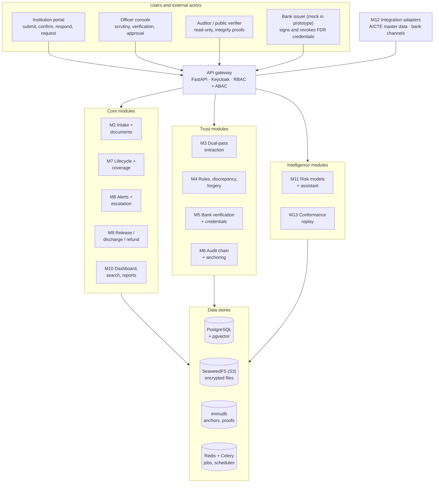
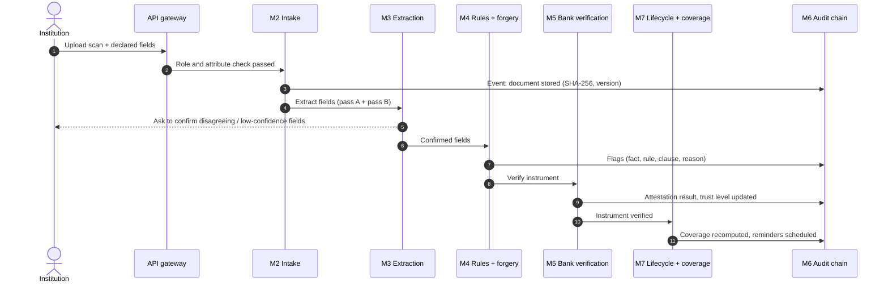
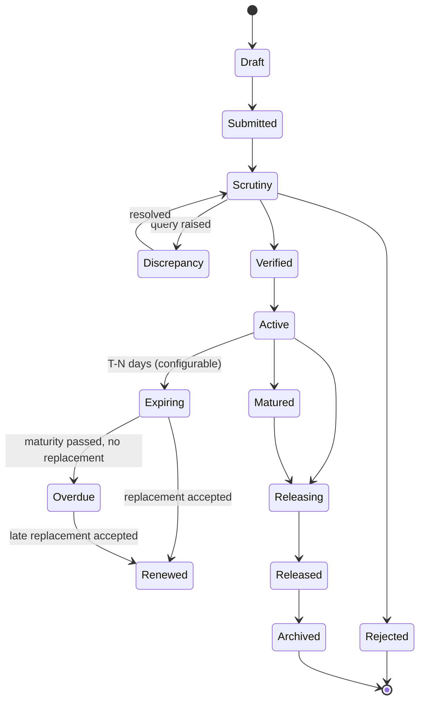
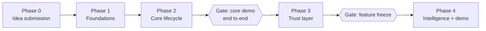

<h1 align="center">DepositTrack</h1>

<p align="center">
  <b>Secure, centralized Security Deposit / FDR management portal for the AICTE Regulation Bureau</b><br/>
  Smart India Hackathon 2026 · Problem Statement <a href="https://www.sih.gov.in/sih2026PS">SIH26265</a>
</p>

<p align="center">
  
  
  
  
</p>

> **Current status:** prototype built end to end in code — backend (all modules M1–M10, M13), mock bank, ML components and the bilingual web app. Automated tests pass; the live stack (Docker) and the UI have not yet been run together. The full design is in **[IMPLEMENTATION_PLAN.md](IMPLEMENTATION_PLAN.md)**. All numbers in [Expected outcomes](#expected-outcomes) are **targets**, not measured results.
>
> Contributors and AI agents: read **[AGENTS.md](AGENTS.md)** before making changes.

---

## Table of contents

1. [Problem statement](#problem-statement)
2. [Objectives](#objectives)
3. [Solution overview](#solution-overview)
4. [Architecture](#architecture)
5. [Instrument lifecycle](#instrument-lifecycle)
6. [Key concepts](#key-concepts)
7. [Modules](#modules)
8. [Tech stack](#tech-stack)
9. [Getting started](#getting-started)
10. [Expected outcomes](#expected-outcomes)
11. [Test scenarios](#test-scenarios)
12. [Progress](#progress)
13. [Work to be done](#work-to-be-done)
14. [Repository structure](#repository-structure)
15. [Research basis](#research-basis)
16. [Open questions](#open-questions)
17. [License](#license)

---

## Problem statement

| Field | Value |
| --- | --- |
| PS ID | SIH26265 |
| Title | Streamline of security deposit/ FDR portal |
| Organization | AICTE (All India Council for Technical Education) |
| Department | Regulation Bureau |
| Category | Software |
| Theme | Smart Automation |

**Background.** AICTE may require technical institutions to submit or maintain security deposits or Fixed Deposit Receipts (FDRs) as part of approval and compliance. Managing them means:

- keeping institution-wise records;
- verifying the instruments;
- monitoring validity and maturity;
- tracking renewal or replacement;
- recording release or refund requests;
- keeping documents available for regulatory verification.

**Current pain.** Fragmented records, manual correspondence and multiple trackers make it hard to keep an accurate, current view of deposit status, pending actions and time-sensitive requirements.

**What the PS asks for:**

- A secure, centralized portal that tracks every deposit across its lifecycle.
- The portal must distinguish what an institution *submitted* from what a bank or financial source has *independently confirmed*.
- The prototype must show measurable improvement in:
  - record accuracy;
  - verification turnaround time;
  - timely renewal monitoring;
  - manual tracking effort;
  - visibility into pending cases.

---

## Objectives

The ten capabilities required by the PS, and how DepositTrack covers each:

| # | PS capability | DepositTrack implementation | Modules |
| --- | --- | --- | --- |
| 1 | Centralized Security Deposit/FDR Repository | Institution-, obligation- and instrument-wise records with documents and status | M1, M2, M10 |
| 2 | Digital Document Management | Encrypted, versioned uploads; bundle splitting; dual-pass OCR + LayoutLMv3 auto-fill | M2, M3 |
| 3 | Verification and Discrepancy Detection | Bank-signed credential check, completeness and policy rules, forgery signals, duplicate detection, clause-linked reasons | M4, M5 |
| 4 | Automated Validity and Maturity Tracking | Lifecycle state machine, daily sweep, coverage-gap forecasting | M7, M8 |
| 5 | Renewal and Replacement Monitoring | Linked instrument chain with a continuity check between old and new | M7 |
| 6 | Release and Refund Workflow | Policy-as-code checklist, time boxes, competent-authority approval, release letter | M9 |
| 7 | Automated Alerts and Escalation | Configurable reminders, overdue escalation, risk-based early escalation | M8 |
| 8 | Dashboard and Management Reports | Status tiles, coverage gaps, verification exposure, scheduled PDF/Excel reports | M10 |
| 9 | Audit Trail and Access Control | Hash-chained audit log, Merkle anchoring, public file verifier, RBAC + ABAC | M1, M6 |
| 10 | System Integration and Data Security | Adapters for AICTE and bank systems (authorised channels only), encryption, key pinning | M5, M12 |

The PS's detailed description also asks for the following, all of which are covered in the plan:

- discharge requests;
- updating permitted fields;
- recording scrutiny observations;
- reviewing document histories;
- missing-document reports;
- flagging incomplete records.

See the [traceability matrix](IMPLEMENTATION_PLAN.md#3-objective-traceability-matrix).

---

## Solution overview

DepositTrack has three layers. The core must work end to end before the other two are built.

| Layer | What it contains | Priority |
| --- | --- | --- |
| **Core** | Repository, upload, extraction, lifecycle engine, reminders, release workflow, dashboard, reports, audit trail, access control | Must work end to end |
| **Trust** | Trust Ladder, bank-signed e-FDR credential, freshness decay, double-pledge detection, forgery signals, Merkle anchoring | Main differentiator |
| **Intelligence** | Coverage forecasting, renewal-risk model with reasons, procedural conformance replay, clause-linked explanations, officer assistant | Built after the core gate |

**Guiding rule:** AI is advisory only. A named officer makes every decision, and every decision is logged with a reason.

---

## Architecture

### System architecture



It is a modular monolith: one FastAPI backend split into module folders, one Next.js frontend, and one Docker Compose file. Modules can later be split into separate services.

### Data flow for one submission



---

## Instrument lifecycle



**Rules:**

- The engine allows only these transitions.
- A renewed instrument links to its replacement, so the full history is one chain.
- *Overdue* and any forecast coverage gap trigger automatic escalation.
- Whether bank attestation is mandatory before an instrument becomes *Active* is configurable. It is an open question for AICTE.

---

## Key concepts

### Trust Ladder

Every field (amount, instrument number, IFSC, maturity date, lien status…) records who vouches for it.

| Level | Name | Reached when |
| --- | --- | --- |
| L0 | Declared | Typed or uploaded by the institution |
| L1 | Machine-checked | Extraction agrees with the declared value; rules pass; forgery signals low |
| L2 | Officer-verified | A named officer confirmed it during scrutiny |
| L3 | Bank-attested | A bank-signed credential or authorised bank channel matches |
| L4 | Live-confirmed | The bank confirms current status (not closed, lien intact) within a freshness window |

- **Instrument trust** = the lowest trust among its key fields.
- **Decay:** confirmations expire. L4 drops to L3 when its freshness window passes, and to L0 if the bank revokes the credential.

### Obligation–Coverage model

AICTE cares whether an institution's **requirement** is covered, not only whether a document exists.

- **Obligation:** required amount × required time window, generated from configurable rules.
- **Coverage:** instruments allocated to an obligation over their validity periods.
- **Coverage gap:** any day on which the covered amount falls below the requirement. The system forecasts the first gap date and opens a task before the gap happens.
- **Verification exposure:** the amount covered only by declared (unconfirmed) instruments, i.e. money AICTE relies on that no bank has confirmed.
- **Continuity check:** a replacement must start no later than the old instrument's maturity and cover the required amount.

### Bank-signed e-FDR credential

The bank signs the FDR details (number, amount, dates, beneficiary, lien status) as a small credential. AICTE verifies the signature with the bank's pinned public key, and the bank revokes the credential when the lien is removed.

This is a **proposal**: the prototype uses a mock bank, and production would need a formal agreement with each bank.

### Other novel elements

| Element | What it does |
| --- | --- |
| Verifiable audit trail | Per-instrument hash chain + periodic Merkle anchoring + a verifier that proves a file is unchanged |
| Double-pledge detection with IFSC lineage | Canonical key catches the same FDR across institutions, even after bank mergers change IFSC codes |
| Dual-pass extraction | Two independent extraction passes; disagreements go to a human |
| Clause-linked explanations | Every flag shows the fact, the failed rule, the regulation clause and a plain-language reason |
| Renewal-risk forecasting | Predicts likely missed renewals and escalates earlier, with reasons |
| Policy-as-code release | Versioned release/discharge/refund rules with time boxes and mandatory approver reason |
| Procedural conformance replay | Checks the Bureau's own procedure against the event log every night |

---

## Modules

| ID | Module | Responsibility | Definition of done |
| --- | --- | --- | --- |
| M1 | Identity and access | Keycloak roles, attribute rules, field-level edit permissions | ≥ 20 allow/deny cases pass |
| M2 | Intake and documents | Upload, malware scan, SHA-256, encrypted versioned storage, document history | Upload → stored → hash shown → access-controlled download |
| M3 | Extraction | OCR + LayoutLMv3 (pass A) and rules/LLM (pass B); human confirmation | ≥ 90% field accuracy on synthetic test set; < 5 s per page on CPU |
| M4 | Rules, discrepancy, forgery | Completeness and policy rules, forgery signals, risk score, scrutiny observations | Every flag shows fact, rule, clause, reason, evidence |
| M5 | Bank verification | Signed credential, bank API simulator, manual letter; live re-check | Tampered amount caught by bank mismatch |
| M6 | Audit chain and anchoring | Hash chain, Merkle anchoring, public verifier | Direct DB edit detected |
| M7 | Lifecycle and coverage | State machine, daily sweep, coverage computation, renewal chain | Clock advance moves FDR Active → Expiring → Renewed; late renewal flagged |
| M8 | Alerts and escalation | Configurable reminders, escalation, digests | One reminder per threshold; all alerts on timeline |
| M9 | Release / discharge / refund | Policy-as-code checklist, approval, release letter, lien removal | Release blocked while any checklist item is red |
| M10 | Dashboard, search, reports | Tiles, drill-downs, search, scheduled reports | Every number drills down to its records |
| M11 | Risk models and assistant | Renewal-risk and discrepancy-risk models; cited assistant | RAGAS score reported |
| M12 | Integration adapters | AICTE master data, bank channels (authorised only) | Institution master import works |
| M13 | Conformance replay | Procedure constraints replayed over the event log | Seeded violation reported with the exact event |

---

## Tech stack

| Layer | Technology |
| --- | --- |
| Frontend | Next.js, React, Tailwind CSS, shadcn/ui, Recharts |
| Backend API | FastAPI (Python 3.11), Pydantic |
| Authentication | Keycloak (OTP/MFA, roles) |
| Background jobs | Celery + Redis, Celery beat |
| Database | PostgreSQL 16 + pgvector |
| File storage | SeaweedFS (S3-compatible); replaces MinIO from the plan, which no longer publishes Docker images |
| Tamper evidence | immudb (permissioned ledger as production option) |
| OCR / document AI | docTR or PaddleOCR, LayoutLMv3 |
| Machine learning | scikit-learn, scikit-image, XGBoost, LightGBM, SHAP, alibi (Anchors) |
| Credentials | Ed25519 signed JSON |
| Assistant | Retrieval over pgvector + LLM, evaluated with ragas |
| Reports | WeasyPrint (PDF), openpyxl (Excel) |
| DevOps | Docker Compose, GitHub Actions, pytest, Playwright |

---

## Getting started

Prerequisites: Python 3.11, Docker Desktop (running), Git.

**1. Infrastructure** (PostgreSQL + pgvector, Redis, SeaweedFS, Keycloak, immudb):

```bash
cp infra/.env.example infra/.env
docker compose -f infra/docker-compose.yml --env-file infra/.env up -d
```

Keycloak imports the `depositrack` realm with seven roles and one development user per role (for example `scrutiny.demo` / `dev-only-scrutiny`). These credentials are for local development only.

**2. Backend**

```bash
cd apps/api
python -m venv .venv
source .venv/bin/activate        # Windows: .venv\Scripts\activate
pip install -e ".[dev]"
alembic upgrade head             # creates the schema
uvicorn app.main:app --reload    # http://localhost:8000/docs
pytest                           # unit tests (no services needed)
```

Useful endpoints: `GET /health`, `GET /api/v1/policy/status` (lists AICTE values still unconfirmed), `GET /api/v1/me` (needs a Keycloak token).

**3. Synthetic FDRs**

```bash
cd ml/synth
python -m venv .venv && source .venv/bin/activate
pip install -e ".[dev]"
python -m fdrsynth --count 20 --out ../../data/synthetic
```

Each sample is a PNG plus a JSON file with field values and word-level boxes and labels for LayoutLMv3. All samples use fictional banks and carry a `SYNTHETIC SAMPLE - NOT A REAL INSTRUMENT` watermark. Banks, cities, wording and value ranges come from `fdrsynth/data/synthetic_lists.json`; pass `--catalog other.json` to use a different list.

---

## Expected outcomes

> **None of these values has been measured yet.** They are the team's targets from the implementation plan. The *Measured* column will be filled in as each component is built and evaluated. Synthetic-data results will be labelled as such.

### Component targets

| Component | Metric | Target | Measured | Status |
| --- | --- | --- | --- | --- |
| Field extraction | Field exact-match after rules (overall) | ≥ 90% | 100% (30 synthetic pages, pass B only) | Met on synthetic data |
| Field extraction | Exact-match on amount and dates | ≥ 95% | 100% (30 synthetic pages) | Met on synthetic data |
| Field extraction | Processing time per page (CPU) | < 5 s | 3.4 s median | Met |
| Forgery signals | Recall on tampered pages | ≥ 0.90 | 0.875 (180 synthetic test pages; copy-paste 0.53) | Below target |
| Forgery signals | False-alarm rate on genuine scans | ≤ 5% | 5.4% | Slightly above target |
| Discrepancy risk | Recall on suspicious class | ≥ 0.95 | — | Not built: the prototype uses explained rule flags plus the forgery bands instead |
| Renewal risk | AUC | ≥ 0.80 | 0.789 (simulated event logs, 180 test institutions) | Below target |
| Renewal risk | Mean warning lead time | ≥ 21 days | 47 days (at 0.7 alarm threshold; 45% of late renewals caught, 0% false alarms at T-30) | Met for lead time |
| Officer assistant | RAGAS faithfulness | ≥ 0.85 | — | Not built (skipped for the prototype) |
| Access control | Allow/deny test cases passing | 100% of ≥ 20 cases | 100% of 28 cases, plus scoping tests | Met |

### PS improvement areas

For the five areas the PS asks the prototype to improve, the plan measures a manual baseline (spreadsheet + email) against the portal on the same cases. No baseline or result numbers exist yet.

| PS improvement area | How it will be measured | Baseline | Result | Status |
| --- | --- | --- | --- | --- |
| Record accuracy | Field errors per 100 instruments | — | — | Pending |
| Verification turnaround time | Time from submission to bank-attested | — | — | Pending |
| Timely renewal monitoring | % of maturities with reminders ≥ 30 days ahead; coverage gaps forecast before they occur | — | — | Pending |
| Manual tracking effort | Officer minutes per case per month | — | — | Pending |
| Visibility into pending cases | Time to answer "which cases need action today?" | — | — | Pending |

---

## Test scenarios

Every test scenario named in the PS has an automated test. "API" tests run the real API with an in-memory database, a fake OCR result and an in-process bank that signs with real Ed25519 keys; the live Docker stack and the browser UI have not yet been run together.

| ID | Scenario | Pass condition | Status |
| --- | --- | --- | --- |
| T-01 | New FDR submission | Stored, hashed, versioned; fields extracted; L1 when clean | Passing (API end-to-end test) |
| T-02 | Repository completeness | All required fields stored and searchable | Passing (API: fields, search and filters) |
| T-03 | Validity tracking | Every instrument in the correct state | Passing (API: sweep with demo clock) |
| T-04 | Approaching maturity | Exactly one reminder per threshold; escalation when ignored | Passing (API: T-90/60/30 once each, overdue escalation) |
| T-05 | Discrepancy identification | Tampered recall ≥ 0.90; false alarms ≤ 5% | Passing for declared-vs-scan and bank mismatch (API); forgery signal measured on synthetic data, see [Expected outcomes](#expected-outcomes) |
| T-06 | Incomplete record | Flagged; listed in missing-documents report | Passing (rule tests); report endpoint built, not separately tested |
| T-07 | Double pledge | Critical flag, including merged-bank IFSC variant | Passing (API, both variants) |
| T-08 | Renewal | Chain linked; late replacement gets a continuity-gap flag | Passing (API, both cases) |
| T-09 | Authorized release processing | Blocked while checklist incomplete; approved after; lien removal recorded | Passing (API) |
| T-10 | Overdue escalation | Escalated to the next role | Passing (API: overdue alert to competent authority) |
| T-11 | Dashboard drill-down | Tile numbers match underlying records | Passing for API counts; UI drill-down not yet tested in a browser |
| T-12 | Audit integrity | Direct DB edit detected by verifier | Passing (API: chain break and anchor mismatch detected) |
| T-13 | Access control | All allow/deny cases pass | Passing (28 role cases + institution and regional scoping) |
| T-14 | Credential forgery | Credential from unknown key rejected | Passing (API) |

---

## Progress

### Done

- [x] Problem statement analysed (SIH26265, official text)
- [x] Research: 15 papers collected (`research/krrish/`, `research/Mayank_Kathe/`)
- [x] Research claims verified against the papers; corrections recorded in [plan §4.3](IMPLEMENTATION_PLAN.md#43-corrections-to-earlier-research-notes)
- [x] Consolidated implementation plan ([IMPLEMENTATION_PLAN.md](IMPLEMENTATION_PLAN.md))
- [x] README
- [x] Backend: 291 automated tests (unit + end-to-end API flows), lint clean
- [x] LayoutLMv3 fine-tuning notebook for a GPU runtime (to be run by the team)

### Roadmap



**Phase 0: idea submission** (PS idea deadline listed as 28 Oct 2026; on hold)
- [ ] Presentation built from the plan (summary, objectives, novelty), using the official SIH 2026 idea template
- [ ] Architecture diagram for the submission
- [ ] Demo storyboard

**Phase 1: foundations**
- [x] Contributor and AI agent rules ([AGENTS.md](AGENTS.md), [CLAUDE.md](CLAUDE.md))
- [x] Docker Compose for PostgreSQL + pgvector, Redis, SeaweedFS, Keycloak, immudb (config validated; stack not yet run end to end)
- [x] CI: backend lint + tests + migrations on PostgreSQL, generator lint + tests, compose check
- [x] Backend skeleton: settings, health, policy status, `/api/v1/me`
- [x] Keycloak realm with seven roles and development users; token verification and role-based permission checks (M1, backend side)
- [x] Database schema for all 15 plan tables, with initial Alembic migration
- [x] Lifecycle state machine with tests for every legal and illegal transition (M7 core)
- [x] Audit hash chain and Merkle root with tamper-detection tests (M6 core)
- [x] Policy configuration with every AICTE value unconfirmed, guarded by tests
- [x] Synthetic FDR generator (watermarked images + word-level labels)
- [x] Web app (Next.js 16) with Keycloak login, built with taste-skill ("achromatic ledger" style), English + Hindi
- [x] Attribute-based access rules (own institution, region, own bank)
- [ ] Answers to the open questions from an AICTE or institution accounts official

**Phase 2: core lifecycle**
- [x] Upload and encrypted, versioned document storage (M2)
- [x] Extraction with auto-fill: RapidOCR + config-driven rules (pass B); LayoutLMv3 pass A plugs in when the Colab-trained model is added (M3)
- [x] Completeness, declared-vs-scan and policy rules, each flag with fact, rule and reason (M4)
- [x] Lifecycle sweep with obligation coverage and gap forecast (M7, N2)
- [x] Reminders once per threshold, overdue / coverage-gap / time-box escalation (M8)
- [x] Dashboard with drill-down, reports as Excel/CSV (M10)
- [ ] **Gate:** full story from upload to maturity reminder works — passes in the API's end-to-end tests; not yet run on the live stack and UI (needs Docker)

**Phase 3: trust layer**
- [x] Signed bank credential via the mock bank, pinned keys, Trust Ladder up to L4 with freshness decay (M5, N3, N4)
- [x] Hash chain, Merkle anchoring (optional immudb receipt) and file verifier (M6)
- [x] Release / discharge / refund workflow with policy checklist, mandatory reason, release letter PDF and bank lien removal (M9, N5)
- [x] Double-pledge and near-duplicate detection with IFSC lineage (N7)
- [x] Forgery signal: RGB-GLCM + ELA + copy-move features, SVM classifier on synthetic tampering (N6)
- [ ] **Gate:** feature freeze

**Phase 4: intelligence and demo readiness**
- [x] Renewal-risk model (LightGBM) with SHAP reasons, scored in the sweep (N9)
- [x] Procedural conformance replay with proposed constraints (N10)
- [ ] Officer assistant with RAGAS score (M11) — skipped for the prototype by decision
- [ ] Manual-vs-portal timing runs; fill in [Expected outcomes](#expected-outcomes)
- [ ] Recorded backup demo video

---

## Work to be done

Immediate next steps, in order:

1. **Run the Docker stack end to end** and confirm Keycloak login, PostgreSQL migrations and SeaweedFS bucket access locally.
2. **Web app scaffold** (`apps/web`, Next.js) with Keycloak login, built with the taste-skill plugin.
3. **Attribute-based access rules** on top of the role matrix (own institution, region, own bank).
4. **Answer the open questions** (below) with an AICTE or institution accounts official. They decide rule values that the code keeps configurable.
5. **Event-log simulator** for the renewal-risk model (N9) and conformance replay (N10).
6. **Core vertical slice (Phase 2):** upload → extraction → rules → lifecycle → reminder → dashboard, before any trust or AI work.
7. **Idea submission** for the PS deadline (on hold).

Module-level build specs are in [plan §8](IMPLEMENTATION_PLAN.md#8-module-by-module-build-specification).

---

## Repository structure

**Current:**

```
DepositTrack-AICTE-FDR-Management/
  README.md
  IMPLEMENTATION_PLAN.md
  AGENTS.md                  # rules for contributors and AI agents
  CLAUDE.md                  # Claude Code entry point (imports AGENTS.md)
  LICENSE
  .github/workflows/ci.yml   # lint, tests, migrations, compose check
  apps/
    api/                     # FastAPI backend
      app/
        core/                # settings, permissions, token verification, policy loader
        db/                  # declarative base, session
        models/              # 15 tables from plan §7.2
        modules/
          auth/              # /api/v1/me
          lifecycle/         # states, trust levels, state machine
          audit/             # hash chain, Merkle root
      alembic/               # migrations
      config/                # policy.example.yaml (AICTE values unconfirmed)
      tests/
  ml/
    synth/                   # synthetic FDR generator (fdrsynth)
  infra/
    docker-compose.yml
    keycloak/                # realm import
    postgres/                # init SQL (pgvector)
    seaweedfs/               # S3 identity config
  research/
    krrish/                  # 8 papers + earlier implementation plan (FDR Guardian)
    Mayank_Kathe/            # 7 papers + research notes
```

**Planned additions:**

```
  apps/web/                  # Next.js: institution, officer, auditor, verifier UIs
  apps/api/app/workers/      # Celery tasks and schedules
  ml/                        # LayoutLMv3, forgery, risk models, RAG
  services/mock-bank/        # issues and revokes signed FDR credentials
  docs/                      # ADRs, API spec, dataset cards
```

---

## Research basis

The design draws on 15 papers; full citations are in [plan §16](IMPLEMENTATION_PLAN.md#16-references).

| Area | Papers | Used for |
| --- | --- | --- |
| Document AI | LayoutLMv3 (2022); IDP Accelerator (2026); Multi-agent asset review (2024) | Extraction, human-in-the-loop, dual-pass cross-checking |
| Forgery and fraud | RGB-GLCM forgery detection (2022); SHAP/Anchor XGBoost (2024) | Forgery signals, grey-area risk classes with reasons |
| Trust and verification | SSI / identity management survey (2022); blockchain certificate revocation (2021) | Bank credential, revocation, freshness, Merkle anchoring |
| Ledger and audit | Blockchain for finance survey (2024); blockchain audit trails (2024) | Permissioned anchoring, hash chains, compliance rules as code |
| Workflow and compliance | SMTSEC smart contract (2020); smart-contract fixed deposits (2023); regulatory compliance monitoring review (2025) | Time-boxed release, lifecycle framing, conformance replay |
| Prediction and explanation | Predictive process monitoring benchmark (2023); regulatory graphs + GenAI (2025); RAGAS (2024) | Renewal-risk model, clause-linked explanations, assistant evaluation |

---

## Open questions

The PS does not specify the following, so DepositTrack keeps them configurable rather than assuming values:

1. Required deposit / FDR amounts and durations by institution type and approval case, and the governing clauses
2. In whose name the FDR is made out, and the required beneficiary / lien wording
3. Accepted instrument kinds (FDR only, or also other forms of security deposit)
4. Conditions for release, discharge and refund, and the competent authority at each level
5. Reminder thresholds and escalation chain
6. Whether bank attestation is mandatory before an instrument becomes active
7. Available AICTE systems/APIs and the authorisation route for integration
8. Which banks hold most AICTE FDRs and whether any offer verification APIs
9. Record retention and RTI/audit access requirements
10. Hosting and SSO requirements

---

## License

This project is licensed under the [MIT License](LICENSE).
