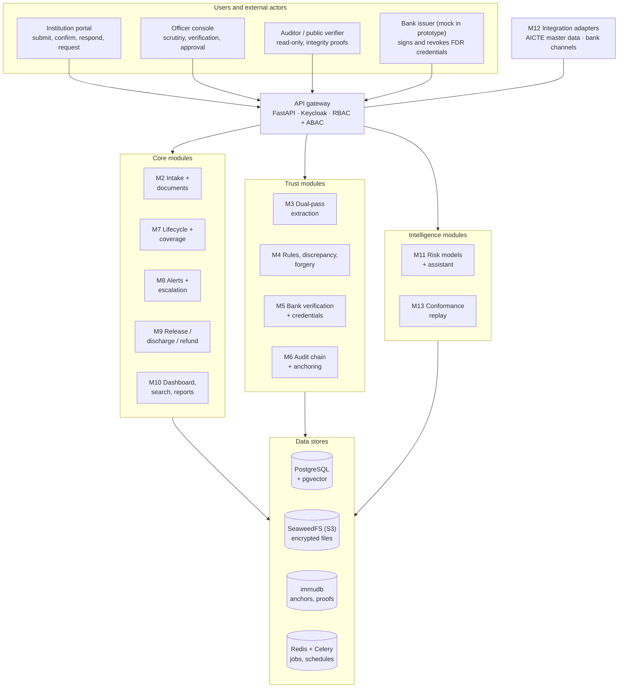
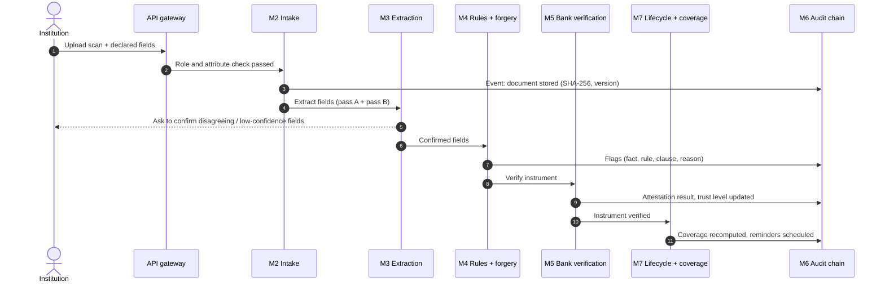
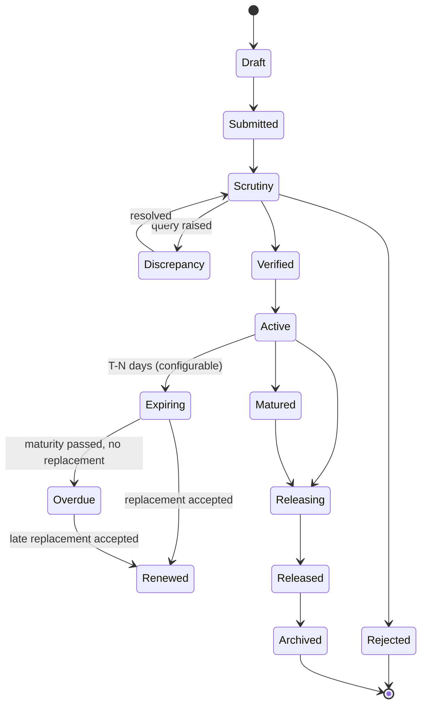
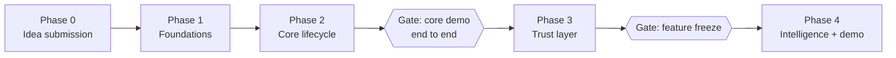

<h1 align="center">DepositTrack</h1>

<p align="center">
  <b>Secure, centralized Security Deposit / FDR management portal for the AICTE Regulation Bureau</b><br/>
  Smart India Hackathon 2026 · Problem Statement <a href="https://www.sih.gov.in/sih2026PS">SIH26265</a>
</p>

<p align="center">
  
  
  
  
</p>

> **Current status (23 Oct 2026):** prototype built in code — backend (modules M1–M10, M12, M13), mock bank and the bilingual web app — and **run on the live Docker stack**: migrations, real master-data import (13,088 AICTE institutions, RBI IFSC bank master), Keycloak login, immudb anchoring and the main screens in a browser. The upload → bank-verification story still waits for a real FDR scan. The full design is in **[IMPLEMENTATION_PLAN.md](IMPLEMENTATION_PLAN.md)**.
>
> **Data policy (25 Oct 2026):** synthetic data only for FDR documents. No public FDR dataset exists, so a generator (`ml/synthetic_fdr/`) makes FDR pages marked `SYNTHETIC - NOT A REAL DEPOSIT`, and results on them are reported as **synthetic results**. Master data comes from public sources; other models are trained on open datasets as **labelled proxies**. See [Expected outcomes](#expected-outcomes) and AGENTS.md rule 5.
>
> Contributors and AI agents: read **[AGENTS.md](AGENTS.md)** before making changes.
>
> **CI is not set up yet:** the workflow file needs a GitHub token with the `workflow` scope to be pushed. Run lint and tests locally before every push.

---

## Table of contents

1. [Problem statement](#problem-statement)
2. [Objectives](#objectives)
3. [Solution overview](#solution-overview)
4. [Architecture](#architecture)
5. [Instrument lifecycle](#instrument-lifecycle)
6. [Key concepts](#key-concepts)
7. [Modules](#modules)
8. [Tech stack](#tech-stack)
9. [Getting started](#getting-started)
10. [Expected outcomes](#expected-outcomes)
11. [Test scenarios](#test-scenarios)
12. [Progress](#progress)
13. [Work to be done](#work-to-be-done)
14. [Repository structure](#repository-structure)
15. [Research basis](#research-basis)
16. [Open questions](#open-questions)
17. [License](#license)

---

## Problem statement

| Field | Value |
| --- | --- |
| PS ID | SIH26265 |
| Title | Streamline of security deposit/ FDR portal |
| Organization | AICTE (All India Council for Technical Education) |
| Department | Regulation Bureau |
| Category | Software |
| Theme | Smart Automation |

**Background.** AICTE may require technical institutions to submit or maintain security deposits or Fixed Deposit Receipts (FDRs) as part of approval and compliance. Managing them means:

- keeping institution-wise records;
- verifying the instruments;
- monitoring validity and maturity;
- tracking renewal or replacement;
- recording release or refund requests;
- keeping documents available for regulatory verification.

**Current pain.** Fragmented records, manual correspondence and multiple trackers make it hard to keep an accurate, current view of deposit status, pending actions and time-sensitive requirements.

**What the PS asks for:**

- A secure, centralized portal that tracks every deposit across its lifecycle.
- The portal must distinguish what an institution *submitted* from what a bank or financial source has *independently confirmed*.
- The prototype must show measurable improvement in:
  - record accuracy;
  - verification turnaround time;
  - timely renewal monitoring;
  - manual tracking effort;
  - visibility into pending cases.

---

## Objectives

The ten capabilities required by the PS, and how DepositTrack covers each:

| # | PS capability | DepositTrack implementation | Modules |
| --- | --- | --- | --- |
| 1 | Centralized Security Deposit/FDR Repository | Institution-, obligation- and instrument-wise records with documents and status | M1, M2, M10 |
| 2 | Digital Document Management | Encrypted, versioned uploads; bundle splitting; dual-pass OCR + LayoutLMv3 auto-fill | M2, M3 |
| 3 | Verification and Discrepancy Detection | Bank-signed credential check, completeness and policy rules, forgery signals, duplicate detection, clause-linked reasons | M4, M5 |
| 4 | Automated Validity and Maturity Tracking | Lifecycle state machine, daily sweep, coverage-gap forecasting | M7, M8 |
| 5 | Renewal and Replacement Monitoring | Linked instrument chain with a continuity check between old and new | M7 |
| 6 | Release and Refund Workflow | Policy-as-code checklist, time boxes, competent-authority approval, release letter | M9 |
| 7 | Automated Alerts and Escalation | Configurable reminders, overdue escalation, risk-based early escalation | M8 |
| 8 | Dashboard and Management Reports | Status tiles, coverage gaps, verification exposure, scheduled PDF/Excel reports | M10 |
| 9 | Audit Trail and Access Control | Hash-chained audit log, Merkle anchoring, public file verifier, RBAC + ABAC | M1, M6 |
| 10 | System Integration and Data Security | Adapters for AICTE and bank systems (authorised channels only), encryption, key pinning | M5, M12 |

The PS's detailed description also asks for the following, all of which are covered in the plan:

- discharge requests;
- updating permitted fields;
- recording scrutiny observations;
- reviewing document histories;
- missing-document reports;
- flagging incomplete records.

See the [traceability matrix](IMPLEMENTATION_PLAN.md#3-objective-traceability-matrix).

---

## Solution overview

DepositTrack has three layers. The core must work end to end before the other two are built.

| Layer | What it contains | Priority |
| --- | --- | --- |
| **Core** | Repository, upload, extraction, lifecycle engine, reminders, release workflow, dashboard, reports, audit trail, access control | Must work end to end |
| **Trust** | Trust Ladder, bank-signed e-FDR credential, freshness decay, double-pledge detection, forgery signals, Merkle anchoring | Main differentiator |
| **Intelligence** | Coverage forecasting, renewal-risk model with reasons, procedural conformance replay, clause-linked explanations, officer assistant | Built after the core gate |

**Guiding rule:** AI is advisory only. A named officer makes every decision, and every decision is logged with a reason.

---

## Architecture

### System architecture



It is a modular monolith: one FastAPI backend split into module folders, one Next.js frontend, and one Docker Compose file. Modules can later be split into separate services.

### Data flow for one submission



---

## Instrument lifecycle



**Rules:**

- The engine allows only these transitions.
- A renewed instrument links to its replacement, so the full history is one chain.
- *Overdue* and any forecast coverage gap trigger automatic escalation.
- Whether bank attestation is mandatory before an instrument becomes *Active* is configurable. It is an open question for AICTE.

---

## Key concepts

### Trust Ladder

Every field (amount, instrument number, IFSC, maturity date, lien status…) records who vouches for it.

| Level | Name | Reached when |
| --- | --- | --- |
| L0 | Declared | Typed or uploaded by the institution |
| L1 | Machine-checked | Extraction agrees with the declared value; rules pass; forgery signals low |
| L2 | Officer-verified | A named officer confirmed it during scrutiny |
| L3 | Bank-attested | A bank-signed credential or authorised bank channel matches |
| L4 | Live-confirmed | The bank confirms current status (not closed, lien intact) within a freshness window |

- **Instrument trust** = the lowest trust among its key fields.
- **Decay:** confirmations expire. L4 drops to L3 when its freshness window passes, and to L0 if the bank revokes the credential.

### Obligation–Coverage model

AICTE cares whether an institution's **requirement** is covered, not only whether a document exists.

- **Obligation:** required amount × required time window, generated from configurable rules.
- **Coverage:** instruments allocated to an obligation over their validity periods.
- **Coverage gap:** any day on which the covered amount falls below the requirement. The system forecasts the first gap date and opens a task before the gap happens.
- **Verification exposure:** the amount covered only by declared (unconfirmed) instruments, i.e. money AICTE relies on that no bank has confirmed.
- **Continuity check:** a replacement must start no later than the old instrument's maturity and cover the required amount.

### Bank-signed e-FDR credential

The bank signs the FDR details (number, amount, dates, beneficiary, lien status) as a small credential. AICTE verifies the signature with the bank's pinned public key, and the bank revokes the credential when the lien is removed.

This is a **proposal**: the prototype uses a mock bank, and production would need a formal agreement with each bank.

### Other novel elements

| Element | What it does |
| --- | --- |
| Verifiable audit trail | Per-instrument hash chain + periodic Merkle anchoring + a verifier that proves a file is unchanged |
| Double-pledge detection with IFSC lineage | Canonical key catches the same FDR across institutions, even after bank mergers change IFSC codes |
| Dual-pass extraction | Two independent extraction passes; disagreements go to a human |
| Clause-linked explanations | Every flag shows the fact, the failed rule, the regulation clause and a plain-language reason |
| Renewal-risk forecasting | Predicts likely missed renewals and escalates earlier, with reasons |
| Policy-as-code release | Versioned release/discharge/refund rules with time boxes and mandatory approver reason |
| Procedural conformance replay | Checks the Bureau's own procedure against the event log every night |

---

## Modules

| ID | Module | Responsibility | Definition of done |
| --- | --- | --- | --- |
| M1 | Identity and access | Keycloak roles, attribute rules, field-level edit permissions | ≥ 20 allow/deny cases pass |
| M2 | Intake and documents | Upload, malware scan, SHA-256, encrypted versioned storage, document history | Upload → stored → hash shown → access-controlled download |
| M3 | Extraction | OCR + LayoutLMv3 (pass A) and rules/LLM (pass B); human confirmation | ≥ 90% field accuracy on a labelled test set of real FDRs; < 5 s per page on CPU |
| M4 | Rules, discrepancy, forgery | Completeness and policy rules, forgery signals, risk score, scrutiny observations | Every flag shows fact, rule, clause, reason, evidence |
| M5 | Bank verification | Signed credential, bank API simulator, manual letter; live re-check | Tampered amount caught by bank mismatch |
| M6 | Audit chain and anchoring | Hash chain, Merkle anchoring, public verifier | Direct DB edit detected |
| M7 | Lifecycle and coverage | State machine, daily sweep, coverage computation, renewal chain | Clock advance moves FDR Active → Expiring → Renewed; late renewal flagged |
| M8 | Alerts and escalation | Configurable reminders, escalation, digests | One reminder per threshold; all alerts on timeline |
| M9 | Release / discharge / refund | Policy-as-code checklist, approval, release letter, lien removal | Release blocked while any checklist item is red |
| M10 | Dashboard, search, reports | Tiles, drill-downs, search, scheduled reports | Every number drills down to its records |
| M11 | Risk models and assistant | Renewal-risk and discrepancy-risk models; cited assistant | RAGAS score reported |
| M12 | Integration adapters | AICTE master data, bank channels (authorised only) | Institution master import works |
| M13 | Conformance replay | Procedure constraints replayed over the event log | Seeded violation reported with the exact event |

---

## Tech stack

| Layer | Technology |
| --- | --- |
| Frontend | Next.js 16 + React 19, TypeScript, plain CSS tokens (taste-skill "framed sheet" style, IBM Plex, light and dark), `oidc-client-ts`; charts drawn as SVG; three.js for the sign-in scene |
| Backend API | FastAPI (Python 3.11), Pydantic, SQLAlchemy 2, Alembic |
| Authentication | Keycloak (roles; OTP/MFA configurable) |
| Background jobs | Lifecycle sweep run from the admin screen / API with a demo clock (Celery + beat from the plan not built; Redis is in Compose for it) |
| Database | PostgreSQL 16 + pgvector |
| File storage | SeaweedFS (S3-compatible); replaces MinIO from the plan, which no longer publishes Docker images |
| Tamper evidence | immudb receipts via `immudb-py` (optional `anchoring` extra); permissioned ledger as production option |
| OCR / document AI | RapidOCR + configured rules (pass B); LayoutLMv3 (pass A) only once the maintainer approves a model trained on FDRs, recorded in its `metrics.json` |
| Machine learning | scikit-learn, scikit-image, LightGBM, SHAP; open datasets fetched with `kagglehub` (`data` extra) |
| Master data | AICTE approved-institutions dashboard; RBI IFSC master via the Razorpay IFSC dataset (MIT) |
| Credentials | Ed25519 signed JSON |
| Assistant | Not built (skipped for the prototype) |
| Reports | reportlab (release letter PDF), openpyxl (Excel), CSV |
| DevOps | Docker Compose, pytest, ruff, ESLint; GitHub Actions pending the `workflow` token scope |

---

## Getting started

Prerequisites: Python 3.11, Docker Desktop (running), Git.

**1. Infrastructure** (PostgreSQL + pgvector, Redis, SeaweedFS, Keycloak, immudb):

```bash
cp infra/.env.example infra/.env
docker compose -f infra/docker-compose.yml --env-file infra/.env up -d
```

Keycloak imports the `depositrack` realm with seven roles and one development user per role (for example `scrutiny.demo` / `dev-only-scrutiny`). These credentials are for local development only.

**2. Backend**

```bash
cd apps/api
python -m venv .venv
source .venv/bin/activate        # Windows: .venv\Scripts\activate
pip install -e ".[dev,ml,anchoring]"
alembic upgrade head             # creates the schema
uvicorn app.main:app --reload    # http://localhost:8000/docs
pytest                           # unit tests (no services needed)
```

The `ml` extra holds the forgery and renewal-risk model libraries; `anchoring` holds the immudb client (`immudb-py`, pinned).

To write immudb receipts for Merkle anchors (N4), set these in `apps/api/.env`:

- `DT_IMMUDB_ENABLED=true`
- `DT_IMMUDB_PASSWORD` set to the `IMMUDB_ADMIN_PASSWORD` value from `infra/.env` (`dev-only-change-me` by default, for local development only). Any other value makes the immudb login fail.
- `DT_IMMUDB_USER` only if you changed it; it defaults to `immudb`, the server's admin user.

Anchors are always stored in the database. If immudb is down or the login fails, the anchor is kept without a receipt, and the reason is returned and listed with it (`store_error`). When an anchor has a receipt, verification reads the root back from immudb with a verified get and compares it with the root recomputed from the events, so editing the events and the anchor row together is detected. With `DT_IMMUDB_ENABLED=false` (the default) anchors are checked locally only and listed as "No external receipt". If immudb is enabled but the client is not installed, `GET /api/v1/system/status` reports it in `immudb_problem` and `POST /api/v1/audit/anchors` returns 503.

**Master data (M12)** — real public sources only, downloaded to `data/open/` (not committed):

```bash
python -m app.masterdata fetch-institutions    # AICTE approved institutions (public dashboard), all states
python -m app.masterdata import-institutions   # 13,088 institutions for 2024-25 at the time of writing
python -m app.masterdata fetch-banks           # RBI IFSC master via the Razorpay IFSC dataset (MIT)
python -m app.masterdata import-banks          # banks, sublet IFSCs, RBI-cited mergers (config/bank_mergers.yaml)
python -m app.seed demo --institution-user-aicte-id <AICTE ID>   # links the dev institution user
```

Sources and parameters are in `config/master_data.yaml`. AICTE regional-office mapping is not published in a downloadable form, so `regions` stays empty (unconfirmed) and institutions import with no region.

- `fetch-institutions` saves a snapshot only if the state lists add up to the all-India list: every institution in exactly one state, no AICTE ID repeated, none missing from the all-India list. `import-institutions` checks a saved snapshot the same way.
- `import-banks` makes the `bank_merger` table exactly `config/bank_mergers.yaml` (a merger removed or corrected there is removed from the table) and rejects cycles in the result. It then recomputes the canonical bank of instruments already stored and records one audit event with the count per old and new bank.
- Bank names come from `IFSC.csv`; sublet IFSCs (listed in `sublet.json`) never name the bank whose prefix they use.
- A merger joins two banks' FDR number series. Two instruments that share a canonical bank only through a merger are flagged as a double pledge (or near-duplicate) only if their issue date and amount do not differ (`cross_merger_match_fields` in `config/checks.yaml`).

**Upgrading a dev database seeded by the old fictional seed** (institutions `SYN-1-000x`): nothing is deleted automatically, and `app.seed` warns when `institution.demo` stays linked to one of them. Reset the database before importing:

```bash
alembic downgrade base && alembic upgrade head   # drops all data, including uploaded instruments
```

Useful endpoints: `GET /health`, `GET /api/v1/policy/status` (lists AICTE values still unconfirmed), `GET /api/v1/me` (needs a Keycloak token).

**3. Models on open datasets** (optional)

No public FDR dataset exists, so each model is trained on the closest open dataset and reported as a proxy. A free Kaggle account and API token are needed (Kaggle → Settings → API → Create New Token; save it as `~/.kaggle/access_token`). Datasets, pinned versions, licences and citations are listed in `ml/open_datasets.json`; downloads go to the git-ignored `data/<name>/`.

```bash
# from the repository root, with the API's virtual environment
pip install -e "apps/api[data,ml]"                   # kagglehub + model libraries
python ml/download_open_data.py bpi-2017             # BPI Challenge 2017 loan-application log
python ml/risk/train.py --out models                 # writes models/renewal_risk_proxy (not loaded live)
python -m pytest ml/tests                            # tests for the download helper and the risk trainer
```

LayoutLMv3: open `ml/layoutlm/train_layoutlmv3_funsd_proxy.ipynb` in Colab on the free T4 GPU and run all cells. It fine-tunes on FUNSD forms as a proxy; the API refuses to load it (`pass_a_enabled: false` in `config/extraction.yaml`, and the loader rejects models whose labels are not FDR fields).

Forgery signal: the Find it again! training is on a separate branch and **not merged**; its first result was close to chance (see [Expected outcomes](#expected-outcomes)). Its licence is not stated, so `download_open_data.py find-it-again` needs `--accept-unconfirmed-licence`.

**4. Mock bank** (simulation of the issuing bank's signed confirmation channel)

```bash
cd services/mock-bank
python -m venv .venv && source .venv/bin/activate
pip install -e ".[dev]"
cp .env.example .env             # development-only placeholders; MB_API_TOKEN must equal DT_BANK_API_TOKEN
python -m mockbank serve --port 8090   # bank operator page at http://localhost:8090
# or, in a second terminal: the bank records an FDR it issued
python -m mockbank register --ifsc <IFSC> --fdr-no <no> --amount <INR, paise allowed> --issue-date <YYYY-MM-DD> --maturity-date <YYYY-MM-DD> --beneficiary "<text>" --depositor "<name>"
```

The bank's ledger starts empty and nothing is generated: the bank side records each FDR it issued (on the operator page, with `register`, which is safe to run while `serve` runs, or with `POST /fdrs`). Records are insert-only.

The mock bank has two tokens. `MB_API_TOKEN` is DepositTrack's: it reads the bank's keys, signed credentials and status, and removes AICTE's lien on release. `MB_OPERATOR_TOKEN` is the bank operator's: it records FDRs, lists the ledger and records an early closure (`POST /simulate/close`). The two must differ, and DepositTrack never gets the operator token. Endpoints for a token that is not set answer 503. An admin then pins the bank keys once in DepositTrack. `/keys` publishes a key for every bank code in `MB_BANK_CODES` from the start; if `MB_BANK_CODES` is empty, pin again after the first FDR of a new bank code. Keys already pinned never change.

An FDR submitted to DepositTrack gets "the bank has no record of this FDR" on "Verify with bank" until the bank records it with its true values.

---

## Expected outcomes

> **Three kinds of result, never mixed.** No public FDR dataset exists. A **proxy** result is measured on the closest open dataset and shows how the method performs there. A **synthetic** result is measured on FDRs from `ml/synthetic_fdr/` (allowed since 25 Oct 2026, AGENTS.md rule 5); those pages are clean and use captions that extraction already knows, so synthetic results are an upper bound. Neither is a result on real FDRs, which needs labelled real scans.

### Component targets

| Component | Metric | Target | Measured | Status |
| --- | --- | --- | --- | --- |
| Field extraction | Field exact-match after rules (overall) | ≥ 90% | 99.4% — **synthetic**, 300 generated FDRs (seed 2027, three layouts), measured through the API's `service.extract`; 93.7% of pages have every field right | Met on synthetic FDRs (an upper bound: known captions). Most misses are the faint diagonal `SYNTHETIC` mark read into the beneficiary line, which a real FDR does not carry. Real FDRs: not measured |
| Field extraction | Exact-match on amount and dates | ≥ 95% | 99.3% — **synthetic**, same set | Met on synthetic FDRs. Real FDRs: not measured |
| Field extraction | Processing time per page (CPU) | < 5 s | 0.66 s mean, 0.75 s p95 (nearest rank) — **synthetic**, same set, Apple M-series CPU, OCR models already loaded, no forgery model | Met on synthetic FDRs. To be timed on real scans |
| Field extraction (LayoutLMv3 method) | Entity F1 on FUNSD forms | — | 0.906 — **proxy**, FUNSD test split (50 forms); answer 0.928, question 0.917, header 0.649 | First Colab run, with the best checkpoint picked on test (slightly optimistic). The merged notebook trains a fixed 1,000 steps and evaluates once (the paper's protocol, which reports 90.29); to be re-run. Pass A off live |
| Forgery signals | Recall on tampered pages | ≥ 0.90 | 0.114 — **proxy**, Find it again! test split (218 receipts, 35 forged); page AUC 0.534 | Far below target, close to chance: the texture/ELA features miss these hand-made edits. Not merged, not live |
| Forgery signals | False-alarm rate on genuine scans | ≤ 5% | 6.6% — **proxy**, same split | Above target |
| Forgery signals | Recall on tampered pages | ≥ 0.90 | 0.67 — **synthetic**, 180 held-out generated FDRs (seed 2026, 95 tampered by `ml/forgery/tamper.py`); by edit: blur 0.89, copy+blur 0.93, insert+blur 0.92, noise 0.72, insertion 0.67, insert+noise 0.57, copy-paste **0.08** | Below target; live off. Copy-paste of another field's own text is the main miss |
| Forgery signals | False-alarm rate on genuine scans | ≤ 5% | 5.9% — **synthetic**, same test pages; the bands are set on a separate 90-page validation split | Just above target |
| Discrepancy risk | Recall on suspicious class | ≥ 0.95 | — | Not built: the prototype uses explained rule flags plus the forgery bands instead |
| Renewal risk | AUC | ≥ 0.80 | 0.789 pooled — **proxy**, BPI Challenge 2017 (6,197 later applications held out by time); by week since the offer 0.588 / 0.599 / 0.640 / 0.691 / 0.833; a one-feature baseline (days since last event) reaches 0.767 pooled | Below target on the proxy; early-week warning is weak. Live scoring off |
| Renewal risk | Mean warning lead time | ≥ 21 days | 14.1 days mean, 16.5 median — **proxy**; 99.8% of missed deadlines caught at 12.0% false alarms | Below target on the proxy, whose deadline is only about 30 days after the offer |
| Officer assistant | RAGAS faithfulness | ≥ 0.85 | — | Not built (skipped for the prototype) |
| Access control | Allow/deny test cases passing | 100% of ≥ 20 cases | 100% of 28 role cases, plus institution, region, bank and mixed-role scoping tests | Met |

### PS improvement areas

For the five areas the PS asks the prototype to improve, the plan measures a manual baseline (spreadsheet + email) against the portal on the same cases. No baseline or result numbers exist yet.

| PS improvement area | How it will be measured | Baseline | Result | Status |
| --- | --- | --- | --- | --- |
| Record accuracy | Field errors per 100 instruments | — | — | Pending |
| Verification turnaround time | Time from submission to bank-attested | — | — | Pending |
| Timely renewal monitoring | % of maturities with reminders ≥ 30 days ahead; coverage gaps forecast before they occur | — | — | Pending |
| Manual tracking effort | Officer minutes per case per month | — | — | Pending |
| Visibility into pending cases | Time to answer "which cases need action today?" | — | — | Pending |

---

## Test scenarios

Every test scenario named in the PS has an automated test. "API" tests run the real API with an in-memory database, a fake OCR result and an in-process bank that signs with real Ed25519 keys. The live Docker stack and the browser UI have been run together (login, dashboards, reports, audit, admin); the upload-to-verification story waits for a real FDR scan.

| ID | Scenario | Pass condition | Status |
| --- | --- | --- | --- |
| T-01 | New FDR submission | Stored, hashed, versioned; fields extracted; L1 when clean | Passing (API end-to-end test); extraction measured on 300 synthetic FDRs (`ml/extraction/evaluate.py`) |
| T-02 | Repository completeness | All required fields stored and searchable | Passing (API: fields, search and filters) |
| T-03 | Validity tracking | Every instrument in the correct state | Passing (API: sweep with demo clock) |
| T-04 | Approaching maturity | Exactly one reminder per threshold; escalation when ignored | Passing (API: T-90/60/30 once each, overdue escalation) |
| T-05 | Discrepancy identification | Tampered recall ≥ 0.90; false alarms ≤ 5% | Passing for declared-vs-scan and bank mismatch (API); forgery signal retrained on synthetic FDRs, below target and off live (proxy on Find it again! near chance), see [Expected outcomes](#expected-outcomes) |
| T-06 | Incomplete record | Flagged; listed in missing-documents report | Passing (rule tests; API: missing fields and documents flagged and listed with their reasons, scoped by region and institution, record leaves the list once the field is filled in or the record is closed, CSV export) |
| T-07 | Double pledge | Critical flag, including merged-bank IFSC variant | Passing (API, both variants; unit tests for a same deposit across a bank merger and for unrelated same-number FDRs of two merged banks) |
| T-08 | Renewal | Chain linked; late replacement gets a continuity-gap flag | Passing (API, both cases) |
| T-09 | Authorized release processing | Blocked while checklist incomplete; approved after; lien removal recorded | Passing (API) |
| T-10 | Overdue escalation | Escalated to the next role | Passing (API: overdue alert to competent authority) |
| T-11 | Dashboard drill-down | Tile numbers match underlying records | Passing for API counts, including requirements of institutions with no deposit; overview opened in a browser on the live stack, drill-down clicks not yet walked |
| T-12 | Audit integrity | Direct DB edit detected by verifier | Passing (API: chain break and anchor mismatch detected; editing events and the anchor row together is caught by the immudb receipt, tested with a mocked immudb) |
| T-13 | Access control | All allow/deny cases pass | Passing (28 role cases + institution, regional, bank and mixed-role scoping; scoping depends on the action, so a role that does not grant it adds no visibility; cases, reports, notifications and instrument detail follow the same rule) |
| T-14 | Credential forgery | Credential from unknown key rejected | Passing (API) |

---

## Progress

### Done

- [x] Problem statement analysed (SIH26265, official text)
- [x] Research: 15 papers collected (`research/krrish/`, `research/Mayank_Kathe/`)
- [x] Research claims verified against the papers; corrections recorded in [plan §4.3](IMPLEMENTATION_PLAN.md#43-corrections-to-earlier-research-notes)
- [x] Consolidated implementation plan ([IMPLEMENTATION_PLAN.md](IMPLEMENTATION_PLAN.md))
- [x] README
- [x] Backend: 464 automated tests (unit + end-to-end API flows), lint clean; mock bank: 48 tests; ml scripts: 24 tests
- [x] Live Docker stack run end to end (23 Oct 2026): migrations, master-data import, Keycloak login, immudb anchoring, main screens in a browser
- [x] Data policy changed to real and open data only; synthetic-data results withdrawn
- [x] Data policy changed again (25 Oct 2026): a labelled synthetic dataset is allowed for FDR documents only

### Roadmap



**Phase 0: idea submission** (PS idea deadline listed as 28 Oct 2026; on hold)
- [ ] Presentation built from the plan (summary, objectives, novelty), using the official SIH 2026 idea template
- [ ] Architecture diagram for the submission
- [ ] Demo storyboard

**Phase 1: foundations**
- [x] Contributor and AI agent rules ([AGENTS.md](AGENTS.md), [CLAUDE.md](CLAUDE.md))
- [x] Docker Compose for PostgreSQL + pgvector, Redis, SeaweedFS, Keycloak, immudb (run end to end on 23 Oct 2026)
- [ ] CI workflow (backend, generator, mock bank, web, compose checks) — written, but not on this branch: pushing `.github/workflows/` needs a GitHub token with the `workflow` scope. Add it once that permission is granted; until then run the checks locally (see [Getting started](#getting-started))
- [x] Backend skeleton: settings, health, policy status, `/api/v1/me`
- [x] Keycloak realm with seven roles and development users; token verification and role-based permission checks (M1, backend side)
- [x] Database schema (21 tables, Alembic migrations 0001–0005)
- [x] Lifecycle state machine with tests for every legal and illegal transition (M7 core)
- [x] Audit hash chain and Merkle root with tamper-detection tests (M6 core)
- [x] Policy configuration with every AICTE value unconfirmed, guarded by tests
- [x] Real master data instead of fictional seeds: AICTE approved institutions (public dashboard) and the RBI IFSC bank master with RBI-cited mergers (M12)
- [x] Synthetic FDR generator, simulator and synthetic-trained notebook removed (PRs #9, #10)
- [x] Synthetic FDR generator brought back under the 25 Oct rule (`ml/synthetic_fdr/`): real RBI IFSC branches named by their IFSC's bank (no payment, office or merged-bank rows) and AICTE institutions; captions and date formats read from `extraction.yaml`; three layouts; `SYNTHETIC - NOT A REAL DEPOSIT` banners plus a diagonal across the fields; word and line boxes with B-/I- tags for LayoutLMv3; seeded so the same `--seed` gives the same files; a mock-bank record per FDR; 65 tests
- [x] Web app (Next.js 16) with Keycloak login, built with taste-skill, English + Hindi
- [x] UI redesign (27 Oct): framed-sheet style with IBM Plex, light and dark themes, route transitions, a 3D Trust Ladder on sign-in and on each FDR; screens use the API's hints and `/me`; taste-skill lint and inspector pass on every screen
- [x] Attribute-based access rules (own institution, region, own bank)
- [ ] Answers to the open questions from an AICTE or institution accounts official

**Phase 2: core lifecycle**
- [x] Upload and encrypted, versioned document storage (M2)
- [x] Forgery signal retrained on synthetic tampered FDRs: recall 0.67 at 5.9% false alarms on held-out pages, bands set on a validation split (below target); the API now loads a forgery model only with `live_scoring: true` and a training-data name, re-read on change, and names the training data in status and in every forgery flag
- [x] Extraction measured on synthetic FDRs (`ml/extraction/evaluate.py`, through `service.extract`): 99.4% exact-match, 99.3% on amount and dates, 0.66 s/page. Fixes found by it: a shorter caption never reads a longer caption's line (config order kept), an IFSC with `O` for `0` is read next to its caption only, the banner is ignored
- [x] Extraction with auto-fill: RapidOCR + config-driven rules (pass B); LayoutLMv3 pass A stays off until the maintainer approves a model trained on FDRs; FUNSD proxy notebook, and the API refuses non-FDR or unapproved models (M3)
- [x] Completeness, declared-vs-scan and policy rules, each flag with fact, rule and reason (M4)
- [x] Lifecycle sweep with obligation coverage and gap forecast (M7, N2)
- [x] Reminders once per threshold, overdue / coverage-gap / time-box escalation (M8)
- [x] Dashboard with drill-down, reports as Excel/CSV (M10)
- [ ] **Gate:** full story from upload to maturity reminder works — passes in the API's end-to-end tests; on the live stack it waits for a real FDR scan to upload

**Phase 3: trust layer**
- [x] Signed bank credential via the mock bank, pinned keys, Trust Ladder up to L4 with freshness decay (M5, N3, N4); the bank operator records issued FDRs on the mock bank's own page
- [x] Hash chain, Merkle anchoring with immudb receipts that are read back on verification, and file verifier (M6)
- [x] Release / discharge / refund workflow with policy checklist, mandatory reason, release letter PDF and bank lien removal (M9, N5)
- [x] Double-pledge and near-duplicate detection with IFSC lineage (N7)
- [x] Forgery signal: RGB-GLCM + ELA + copy-move features with an SVM classifier (N6)
- [ ] Forgery signal that works on real forgeries: the Find it again! retrain reached only AUC 0.534 (proxy), so it is not merged
- [ ] **Gate:** feature freeze

**Phase 4: intelligence and demo readiness**
- [x] Renewal-risk method (LightGBM + SHAP reasons) measured on the BPI Challenge 2017 log as a proxy, pooled AUC 0.789 (PR #10); live scoring off (the API refuses models without `live_scoring: true`) until DepositTrack has its own renewal history (N9)
- [x] Procedural conformance replay with proposed constraints (N10)
- [ ] Officer assistant with RAGAS score (M11) — skipped for the prototype by decision
- [ ] Manual-vs-portal timing runs; fill in [Expected outcomes](#expected-outcomes)
- [ ] Recorded backup demo video

---

## Work to be done

Immediate next steps, in order:

1. **Synthetic FDRs** from the generator (PR #14), marked `SYNTHETIC - NOT A REAL DEPOSIT`, to walk the upload → extraction → bank verification story on a demo database. A real FDR scan (with the owner's consent, personal details redacted) is still wanted for final validation; record the same FDR at the mock bank (its operator page) before "Verify with bank".
2. **Forgery signal:** retrain on synthetic FDRs (PR #16) and report the result as synthetic; if it still misses the targets, try other features or keep the signal off and rely on the bank cross-check.
3. **Re-run the LayoutLMv3 notebook** with the merged protocol (fixed 1,000 steps, single evaluation) and record the score.
4. **Demo story walk-through** (plan §12) on the live stack with the redesigned UI.
5. **CI workflow** once the GitHub token has the `workflow` scope.
6. **Answer the open questions** (below) with an AICTE or institution accounts official, including the state → AICTE regional office mapping.
7. **Idea submission** for the PS deadline (on hold).

Module-level build specs are in [plan §8](IMPLEMENTATION_PLAN.md#8-module-by-module-build-specification).

---

## Repository structure

```
DepositTrack-AICTE-FDR-Management/
  README.md
  IMPLEMENTATION_PLAN.md
  AGENTS.md                  # rules for contributors and AI agents
  CLAUDE.md                  # Claude Code entry point (imports AGENTS.md and CONTEXT.md)
  CONTEXT.md                 # hand-over notes: current state, decisions, next steps
  LICENSE
  apps/
    api/                     # FastAPI backend
      app/
        api/                 # HTTP routes (instruments, cases, dashboard, audit, admin, ...)
        core/                # settings, permissions, ABAC scoping, token verification, policy loader
        db/                  # declarative base, session
        models/              # 21 tables (plan §7.2 plus bank master, mergers, anchor membership)
        modules/             # alerts, audit, auth, bank, checks, extraction, forgery, instruments,
                             # lifecycle, masterdata, release, risk, storage
        masterdata.py        # fetch / import public master data
        seed.py              # development accounts
      alembic/               # migrations 0001-0005
      config/                # every rule file (policy, extraction, checks, workflow, alerts,
                             # conformance, master_data, bank_mergers)
      seed/                  # development account list
      tests/                 # unit + end-to-end API tests; fixtures are excerpts of real public data
    web/                     # Next.js: institution, officer, auditor, verifier screens (English + Hindi)
  services/
    mock-bank/               # simulated issuing bank: operator page, insert-only ledger, signed credentials
  ml/
    open_datasets.json       # open datasets: pinned Kaggle versions, licences, citations
    synthetic_fdr/           # synthetic FDR generator (fdrsynth), labelled SYNTHETIC; output in data/synthetic_fdr/
    extraction/              # extraction measurement on synthetic FDRs (evaluate.py)
    download_open_data.py    # downloads a catalog entry into data/<name>/
    forgery/                 # forgery signal training (Find it again! retrain on a separate branch)
    risk/                    # renewal-risk proxy training (BPI Challenge 2017)
    layoutlm/                # LayoutLMv3 FUNSD proxy notebook
    tests/                   # tests for the ml scripts
  infra/
    docker-compose.yml
    keycloak/                # realm import
    postgres/                # init SQL (pgvector)
    seaweedfs/               # S3 identity config
  research/
    krrish/                  # 8 papers + earlier implementation plan (FDR Guardian)
    Mayank_Kathe/            # 7 papers + research notes
```

Generated and downloaded files are not committed: `data/open/` (public master data), `data/synthetic_fdr/` (generated FDRs), `data/<dataset>/` (open datasets), `models/` (trained models), `var/` (local storage, keys, ledgers).

**Planned additions:** `apps/api/app/workers/` (Celery tasks and schedules), `docs/` (ADRs, API spec, dataset cards).

---

## Research basis

The design draws on 15 papers; full citations are in [plan §16](IMPLEMENTATION_PLAN.md#16-references).

| Area | Papers | Used for |
| --- | --- | --- |
| Document AI | LayoutLMv3 (2022); IDP Accelerator (2026); Multi-agent asset review (2024) | Extraction, human-in-the-loop, dual-pass cross-checking |
| Forgery and fraud | RGB-GLCM forgery detection (2022); SHAP/Anchor XGBoost (2024) | Forgery signals, grey-area risk classes with reasons |
| Trust and verification | SSI / identity management survey (2022); blockchain certificate revocation (2021) | Bank credential, revocation, freshness, Merkle anchoring |
| Ledger and audit | Blockchain for finance survey (2024); blockchain audit trails (2024) | Permissioned anchoring, hash chains, compliance rules as code |
| Workflow and compliance | SMTSEC smart contract (2020); smart-contract fixed deposits (2023); regulatory compliance monitoring review (2025) | Time-boxed release, lifecycle framing, conformance replay |
| Prediction and explanation | Predictive process monitoring benchmark (2023); regulatory graphs + GenAI (2025); RAGAS (2024) | Renewal-risk model, clause-linked explanations, assistant evaluation |

---

## Open questions

The PS does not specify the following, so DepositTrack keeps them configurable rather than assuming values:

1. Required deposit / FDR amounts and durations by institution type and approval case, and the governing clauses
2. In whose name the FDR is made out, and the required beneficiary / lien wording
3. Accepted instrument kinds (FDR only, or also other forms of security deposit)
4. Conditions for release, discharge and refund, and the competent authority at each level
5. Reminder thresholds and escalation chain
6. Whether bank attestation is mandatory before an instrument becomes active
7. Available AICTE systems/APIs and the authorisation route for integration
8. Which banks hold most AICTE FDRs and whether any offer verification APIs
9. Record retention and RTI/audit access requirements
10. Hosting and SSO requirements

---

## License

This project is licensed under the [MIT License](LICENSE).
