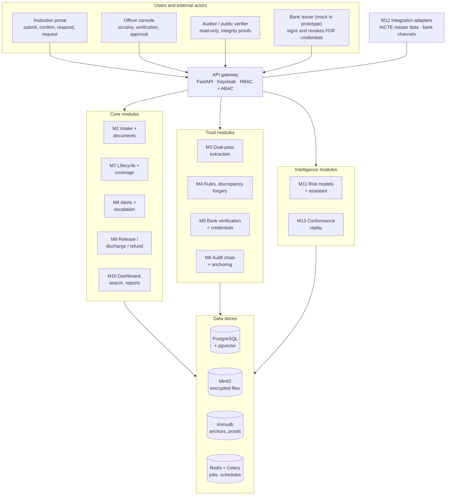
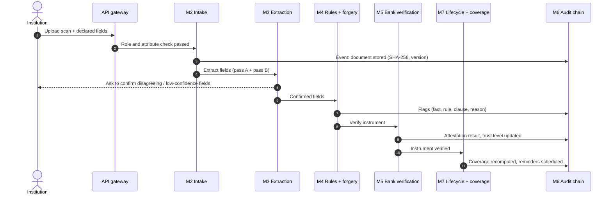
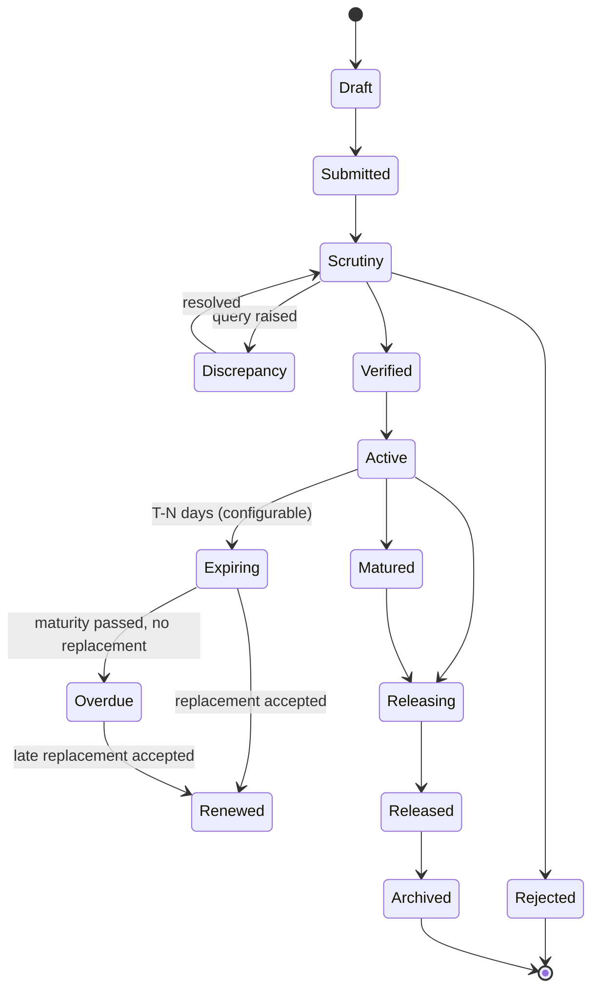

<h1 align="center">DepositTrack</h1>

  <b>Secure, centralized Security Deposit / FDR management portal for the AICTE Regulation Bureau</b> 
  Smart India Hackathon 2026 · Problem Statement <a href="https://www.sih.gov.in/sih2026PS">SIH26265</a>

  
  
  
  

> **Current status:** research and design are complete; no application code has been written yet. The full design is in **[IMPLEMENTATION_PLAN.md](IMPLEMENTATION_PLAN.md)**. All numbers in this README are **targets**, not measured results.

---

## Table of contents

1. [Problem statement](#problem-statement)
2. [Objectives](#objectives)
3. [Solution overview](#solution-overview)
4. [Architecture](#architecture)
5. [Instrument lifecycle](#instrument-lifecycle)
6. [Key concepts](#key-concepts)
7. [Modules](#modules)
8. [Tech stack](#tech-stack)
9. [Expected outcomes](#expected-outcomes)
10. [Test scenarios](#test-scenarios)
11. [Progress](#progress)
12. [Work to be done](#work-to-be-done)
13. [Repository structure](#repository-structure)
14. [Research basis](#research-basis)
15. [Open questions](#open-questions)
16. [License](#license)

---

## Problem statement

| Field | Value |
| --- | --- |
| PS ID | SIH26265 |
| Title | Streamline of security deposit/ FDR portal |
| Organization | AICTE (All India Council for Technical Education) |
| Department | Regulation Bureau |
| Category | Software |
| Theme | Smart Automation |

**Background.** AICTE may require technical institutions to submit or maintain security deposits or Fixed Deposit Receipts (FDRs) as part of approval and compliance. Managing them means:

- keeping institution-wise records;
- verifying the instruments;
- monitoring validity and maturity;
- tracking renewal or replacement;
- recording release or refund requests;
- keeping documents available for regulatory verification.

**Current pain.** Fragmented records, manual correspondence and multiple trackers make it hard to keep an accurate, current view of deposit status, pending actions and time-sensitive requirements.

**What the PS asks for:**

- A secure, centralized portal that tracks every deposit across its lifecycle.
- The portal must distinguish what an institution *submitted* from what a bank or financial source has *independently confirmed*.
- The prototype must show measurable improvement in:
  - record accuracy;
  - verification turnaround time;
  - timely renewal monitoring;
  - manual tracking effort;
  - visibility into pending cases.

---

## Objectives

The ten capabilities required by the PS, and how DepositTrack covers each:

| # | PS capability | DepositTrack implementation | Modules |
| --- | --- | --- | --- |
| 1 | Centralized Security Deposit/FDR Repository | Institution-, obligation- and instrument-wise records with documents and status | M1, M2, M10 |
| 2 | Digital Document Management | Encrypted, versioned uploads; bundle splitting; dual-pass OCR + LayoutLMv3 auto-fill | M2, M3 |
| 3 | Verification and Discrepancy Detection | Bank-signed credential check, completeness and policy rules, forgery signals, duplicate detection, clause-linked reasons | M4, M5 |
| 4 | Automated Validity and Maturity Tracking | Lifecycle state machine, daily sweep, coverage-gap forecasting | M7, M8 |
| 5 | Renewal and Replacement Monitoring | Linked instrument chain with a continuity check between old and new | M7 |
| 6 | Release and Refund Workflow | Policy-as-code checklist, time boxes, competent-authority approval, release letter | M9 |
| 7 | Automated Alerts and Escalation | Configurable reminders, overdue escalation, risk-based early escalation | M8 |
| 8 | Dashboard and Management Reports | Status tiles, coverage gaps, verification exposure, scheduled PDF/Excel reports | M10 |
| 9 | Audit Trail and Access Control | Hash-chained audit log, Merkle anchoring, public file verifier, RBAC + ABAC | M1, M6 |
| 10 | System Integration and Data Security | Adapters for AICTE and bank systems (authorised channels only), encryption, key pinning | M5, M12 |

The PS's detailed description also asks for the following, all of which are covered in the plan:

- discharge requests;
- updating permitted fields;
- recording scrutiny observations;
- reviewing document histories;
- missing-document reports;
- flagging incomplete records.

See the [traceability matrix](IMPLEMENTATION_PLAN.md#3-objective-traceability-matrix).

---

## Solution overview

DepositTrack has three layers. The core must work end to end before the other two are built.

| Layer | What it contains | Priority |
| --- | --- | --- |
| **Core** | Repository, upload, extraction, lifecycle engine, reminders, release workflow, dashboard, reports, audit trail, access control | Must work end to end |
| **Trust** | Trust Ladder, bank-signed e-FDR credential, freshness decay, double-pledge detection, forgery signals, Merkle anchoring | Main differentiator |
| **Intelligence** | Coverage forecasting, renewal-risk model with reasons, procedural conformance replay, clause-linked explanations, officer assistant | Built after the core gate |

**Guiding rule:** AI is advisory only. A named officer makes every decision, and every decision is logged with a reason.

---

## Architecture

### System architecture

It is a modular monolith: one FastAPI backend split into module folders, one Next.js frontend, and one Docker Compose file. Modules can later be split into separate services.

### Data flow for one submission

---

## Instrument lifecycle

**Rules:**

- The engine allows only these transitions.
- A renewed instrument links to its replacement, so the full history is one chain.
- *Overdue* and any forecast coverage gap trigger automatic escalation.
- Whether bank attestation is mandatory before an instrument becomes *Active* is configurable. It is an open question for AICTE.

---

## Key concepts

### Trust Ladder

Every field (amount, instrument number, IFSC, maturity date, lien status…) records who vouches for it.

| Level | Name | Reached when |
| --- | --- | --- |
| L0 | Declared | Typed or uploaded by the institution |
| L1 | Machine-checked | Extraction agrees with the declared value; rules pass; forgery signals low |
| L2 | Officer-verified | A named officer confirmed it during scrutiny |
| L3 | Bank-attested | A bank-signed credential or authorised bank channel matches |
| L4 | Live-confirmed | The bank confirms current status (not closed, lien intact) within a freshness window |

- **Instrument trust** = the lowest trust among its key fields.
- **Decay:** confirmations expire. L4 drops to L3 when its freshness window passes, and to L0 if the bank revokes the credential.

### Obligation–Coverage model

AICTE cares whether an institution's **requirement** is covered, not only whether a document exists.

- **Obligation:** required amount × required time window, generated from configurable rules.
- **Coverage:** instruments allocated to an obligation over their validity periods.
- **Coverage gap:** any day on which the covered amount falls below the requirement. The system forecasts the first gap date and opens a task before the gap happens.
- **Verification exposure:** the amount covered only by declared (unconfirmed) instruments, i.e. money AICTE relies on that no bank has confirmed.
- **Continuity check:** a replacement must start no later than the old instrument's maturity and cover the required amount.

### Bank-signed e-FDR credential

The bank signs the FDR details (number, amount, dates, beneficiary, lien status) as a small credential. AICTE verifies the signature with the bank's pinned public key, and the bank revokes the credential when the lien is removed.

This is a **proposal**: the prototype uses a mock bank, and production would need a formal agreement with each bank.

### Other novel elements

| Element | What it does |
| --- | --- |
| Verifiable audit trail | Per-instrument hash chain + periodic Merkle anchoring + a verifier that proves a file is unchanged |
| Double-pledge detection with IFSC lineage | Canonical key catches the same FDR across institutions, even after bank mergers change IFSC codes |
| Dual-pass extraction | Two independent extraction passes; disagreements go to a human |
| Clause-linked explanations | Every flag shows the fact, the failed rule, the regulation clause and a plain-language reason |
| Renewal-risk forecasting | Predicts likely missed renewals and escalates earlier, with reasons |
| Policy-as-code release | Versioned release/discharge/refund rules with time boxes and mandatory approver reason |
| Procedural conformance replay | Checks the Bureau's own procedure against the event log every night |

---

## Modules

| ID | Module | Responsibility | Definition of done |
| --- | --- | --- | --- |
| M1 | Identity and access | Keycloak roles, attribute rules, field-level edit permissions | ≥ 20 allow/deny cases pass |
| M2 | Intake and documents | Upload, malware scan, SHA-256, encrypted versioned storage, document history | Upload → stored → hash shown → access-controlled download |
| M3 | Extraction | OCR + LayoutLMv3 (pass A) and rules/LLM (pass B); human confirmation | ≥ 90% field accuracy on synthetic test set; < 5 s per page on CPU |
| M4 | Rules, discrepancy, forgery | Completeness and policy rules, forgery signals, risk score, scrutiny observations | Every flag shows fact, rule, clause, reason, evidence |
| M5 | Bank verification | Signed credential, bank API simulator, manual letter; live re-check | Tampered amount caught by bank mismatch |
| M6 | Audit chain and anchoring | Hash chain, Merkle anchoring, public verifier | Direct DB edit detected |
| M7 | Lifecycle and coverage | State machine, daily sweep, coverage computation, renewal chain | Clock advance moves FDR Active → Expiring → Renewed; late renewal flagged |
| M8 | Alerts and escalation | Configurable reminders, escalation, digests | One reminder per threshold; all alerts on timeline |
| M9 | Release / discharge / refund | Policy-as-code checklist, approval, release letter, lien removal | Release blocked while any checklist item is red |
| M10 | Dashboard, search, reports | Tiles, drill-downs, search, scheduled reports | Every number drills down to its records |
| M11 | Risk models and assistant | Renewal-risk and discrepancy-risk models; cited assistant | RAGAS score reported |
| M12 | Integration adapters | AICTE master data, bank channels (authorised only) | Institution master import works |
| M13 | Conformance replay | Procedure constraints replayed over the event log | Seeded violation reported with the exact event |

---

